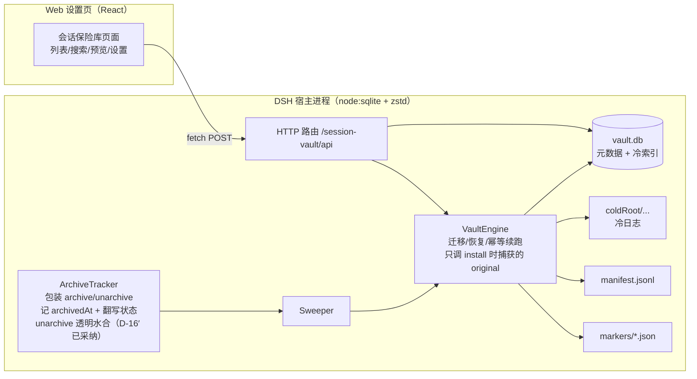
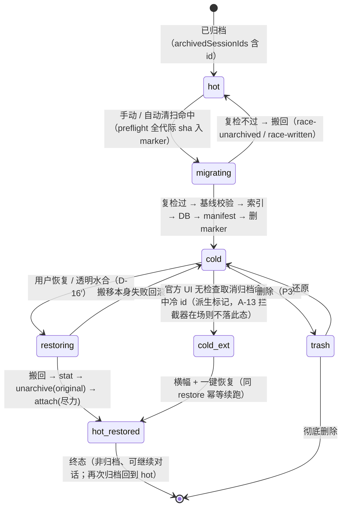
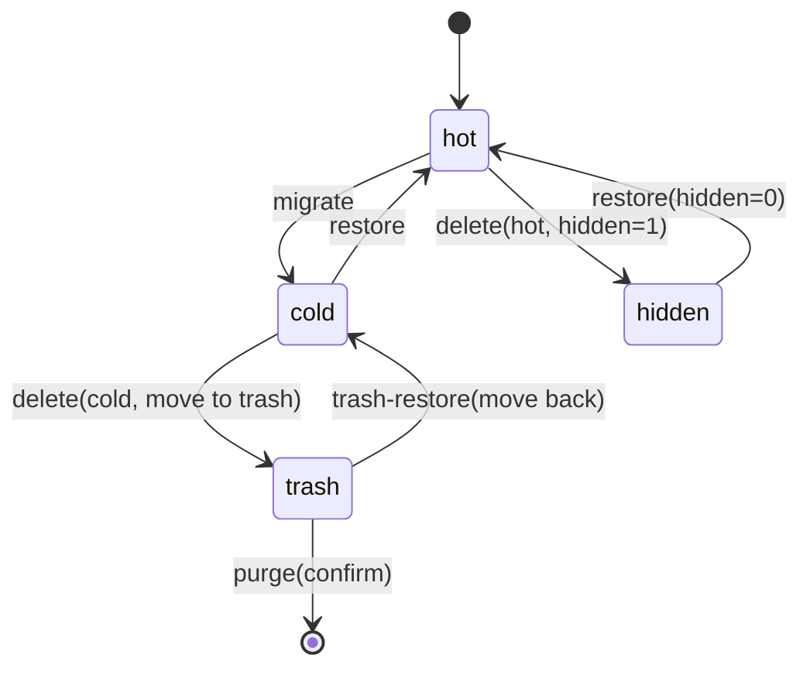

# dsh-session-vault（会话保险库）设计文档

- 版本：v0.4.2（2026-10-27：首轮设计评审 12 条按用户裁定落地——I-2 分域、恢复冷却期、gaps 解除路径、文件清单、状态行与指针同步；v0.4.1 = §19.11 记录用户裁定——按建议默认值实施，进入工程模式评审与开发；v0.4.0 = 新增 §19 P4「子代理会话冷存」设计（class S）；class A 口径不变。v0.3.10 = 2026-10-26 第二轮设计评审修订：trash schema 与伪代码对齐（sha256/row_json/expires_at）、目录树回收站移至 vaultRoot、ui-contract 定义、A-P3-10、体积粗估；v0.3.9 为 P3 设计评审修订：回收站权威位置、快捷键全库统一、FR-13 收窄并记录弃做、补伪代码与 A-P3-7/8/9；v0.3.8 为新增 §18 P3 设计；v0.3.7 为 2026-10-23 代码评审校准：§13 升级失败方向改为「抛错拒开」，只读降级延后 P2；§15 P0-3 注明静态扫描版已交付、活体探测待真机）
- 历史：v0.3.6（2026-10-23）A-19 写面口径与 §7 对齐——合法写面 = {vaultRoot, sessionsRoot, 已知冷根}，严禁工作区目录
- 历史：v0.3.5（2026-10-23）评审通过后按评审员 6 条非阻塞建议修订
- 历史：v0.3.4（2026-10-23）用户裁定 A/B/C：版本门保留 + 声明收窄；ArchiveTracker 负责 hot-restored→hot 翻写；Windows 目录 fsync 降级
- 历史：v0.3.2（2026-10-23）二轮审计修订：R-1/R-4/R-12/R-13/R-15/R-16/R-20/R-25 的 9 处与坐标残留全部修复；R-24 坐标重钉仍留 P0 spike
- 历史：v0.3.1（2026-10-22）合并会诊 #123 的 26 组修订、D4 改为「已归档 + 上次活跃 > N 天」、autoMigrate 默认关、新增侧栏入口
- 来源说明：v0.3 正文由会诊子会话起草并落盘（2026-10-22 16:47–16:52），主代理复核了 D6′/D-16′/D17/D19 的宿主依据并完成本轮修订；26 组修订已逐条审计完成（2026-10-23，见 docs/2026-10-23-design-audit.md）。
- 日期：2026-10-22
- 状态：P4 设计已定稿并经用户确认；2026-10-27 首轮评审 **FAIL**（1🔴/7🟡/4🔵）已按用户裁定全部处理，**复评 PASS**（无未解 🔴/🟡，token 已签发）；**P4 实施未完成**（2026-10-27：eng-coder 触达 30 分钟兜底被中断；全量 268 项测试 **9 项失败**，其中 **2 项为 class A 回归**（A-12 / A1））——待用户裁决后续，修复清单见实施计划。见 §19.11 / §19.12
- 需求来源：[需求档](2026-10-22-session-vault-requirements.md)（v0.4.1）
- 调研依据：[插件面](research/plugin-api.md) · [存储与检索](research/cold-storage.md) · [目录形态实测](research/session-dir-shapes-2026-10-22.md)
- 评审依据：[会诊 #123 纪要](consult-minutes/2026-10-22-consult-123-minutes.md) · [第 2 轮独立评审](2026-10-22-session-vault-design-review.md) · [工程预评审](2026-10-22-session-vault-eng-readiness.md)
- 目标宿主：DSH 0.2.1-rc.2（已测）；0.2.0-rc.1 未测，会被 `engines.dsh` 门跳过（D9）

## 1. 背景与目标（摘要）

把 DSH 的「归档」从纯标记升级为**可配置冷存储**：已归档且上次活跃超过 N 天（默认 14）的会话自动搬离
`~/.dsh/sessions`，热目录只保留冷索引（元数据 + 全文 + 审计），需要时一键搬回并解除归档；
并提供归档管理 UI（列表/搜索/预览/收藏/批量/删除/诊断）。完整目标与非目标见[需求档 §3](2026-10-22-session-vault-requirements.md#3-目标)。

## 2. 现状约束（全部已核实）

> 证据坐标（2026-10-22 重钉，R-24）：
> ① **坐标一律指向可读副本**：`<workspace-root>/harness-checkout/apps/desktop/.desktop-build/targets/win-x64/dsh/node_modules/@deepseek-ai/...`（构建后 JS 行号）。`resources/app.asar` 是**文件不是目录**，rg/read 打不开，不再作为坐标。
> ② **版本钉法**：`npx @electron/asar extract-file` 抽出同名文件与副本 diff 一致后，才可声称「与检出一致」；本档引用的行号在重钉完成前**不当定论**。
> ③ **两套坐标不可混引**：TS 源码行号与构建后 JS 行号是两套体系，引用时须显式标注；旧档曾引 P2:742-756 为 warn 位置，实为 `recoverPendingMutation`。
> 引用符号：**P1** dsh-session-persistence-jsonl · **P2** dsh-workspace · **P3** dsh-session-query · **P4** dsh-session-query-sqlite · **P5** dsh-session-projection-cache · **P6** dsh-session/lib/types/known-event-types.js（前五个为副本内 `lib/index.js`，P6 为副本内该文件；行号一律指构建后 JS）。

| 编号 | 事实 | 证据 | 对设计的影响 |
| --- | --- | --- | --- |
| C-1 | 归档只写 `global.archivedSessionIds`，不动文件 | P2 `archiveSession()`；实测 118/118 目录仍在盘（as-of 2026-10-22） | 冷存储必须自己搬文件 |
| C-2 | `archiveSession` 要求会话存在且非活跃；`unarchiveSession` **不做存在性检查** | P2:506-561（注释原文 `an entry whose session is gone still resolves`） | 恢复必须先搬文件再取消归档；冷 id 被外部取消归档 → A-13 |
| C-3 | 118 个归档 id 中 117 个仍在 `tables.workspaces[].sessionIds` 记账里 | `workspace.json` 实测（as-of 2026-10-22）；宿主域声明注释明写「归档保留 sessionIds 槽位以便取消归档还原位置」 | **不是脏数据，是宿主有意设计**（B-1）→ 迁移**不 detach**（D6′），宿主下次写操作自会按 sessionPath 剪枝 |
| C-4 | 工作区实体暴露 `attachSession`/`detachSession`，注册表暴露 `get/list/resolveByPath` | P2:102-104,178,209-215 | `attachSession` 是头插（恢复后位置丢失）且要求 cwd 精确存在 → 恢复时 attach 只作尽力步骤 |
| C-5 | `persistence.list()` 有四种状态：目录缺失→不列出；目录在但无合法代际名→静默跳过；**父 projectKey ≠ header.cwd→抛错**；同 id 两个 projectKey→duplicate 抛错 | P1:3048-3052、3411-3441、3468-3477、3125-3128 | 冷目录绝不能放在 sessions 之下；搬回必须回原 projectKey |
| C-6 | 内置 FTS 对账把「不在 `persistence.list()`」的行物理删除 | P4:656、681、760-769 | 冷会话必须自建索引 |
| C-7 | v4 日志是**多帧 zstd**（首帧 header + 每 append 一帧，带 xxhash），帧边界不解压可扫 | P1:1293-1297、1305-1368、3269-3281 | 自己实现帧遍历（不搜 magic，按结构走） |
| C-8 | 事件形状与注入：`user/message.data.source.kind` 只有 `user` 是真人输入；`assistant/message` 里 `reasoning` 占大头 | P1 `worker.cjs:10718`（message-sources 归属校验/映射表，含 `runtime-context`）+ 30 会话抽样实测 | 索引只收 `kind=user` + assistant `text` + 标题 |
| C-9 | `node:zlib` 自带 `zstdDecompress`；`node:sqlite` 与 FTS5 可用 | 宿主 Node 24.21 / Electron 44 实测 | 不引入第三方原生依赖 |
| C-10 | 归档集合没有时间戳 | `workspace.json` 结构 | 阈值改用 lastActiveAt；archivedAt 仅作展示与审计 |
| C-11 | **会话身份 = 路径**：文件路径必须等于 `generationLogPath(root, header.cwd, header.id)` | P1:3389（`assertStoredIdentity` 内的 `expectedPath`）；projectKey 算法 P1:880-900；复算 35/35 命中（实测） | 恢复必须用 header.cwd 复算 projectKey；不一致一律 fail-closed |
| C-12 | 投影缓存已改为 per-record（`storages/session_projcache/sessions/<id>.json`），无「全表列会话」 | P5:89-101、168-197 | 搬走**不会**产生幽灵会话，只留孤儿缓存垃圾 |
| C-13 | 读 v0/v3 代际会**迁移写新文件** | P1:2123-2147 | 冷态禁止 `persistence.open` / sessionQuery 读模型；**允许**自研只读帧遍历 + `zstdDecompressSync`（无写路径） |
| C-14 | 写盘临时文件 `<log>.<hex>.tmp` 存在即表示写入在飞 | P1:3194 附近 | 迁移前见到 `*.tmp` 直接跳过本轮 |
| C-15 | 一个会话目录只放日志（无附件/锁/spill） | 2097 个目录实测：非日志文件 0、`*.tmp` 0（as-of 2026-10-22 16:0x） | 搬移单位 = 整目录；附件不搬 |
| C-16 | 会话目录**可能并存多个代际日志**（22/2097 目录；118 个归档会话中 1 个命中） | 目录形态实测（as-of 2026-10-22） | 搬移按整目录即可；**preflight 不得要求「只有一个日志文件」**；索引只取宿主当前代际（与 `resolveGenerationInDirectory` 同口径） |

### 2.1 数据安全不变量

完整版与三个重点工作区的实测影响见[安全边界档](2026-10-22-session-vault-safety.md)（v0.4.1）。摘要：

- **class A** 只处理 `archivedSessionIds` 中的会话，未归档会话不读不搬（I-2/I-3）；**class S**（P4 子代理会话）按 §19 / I-15 另行判定——它不需要、也不允许进归档集合（I-17）；
- 迁移前校验 `目录名 == projectKey(header.cwd)`（I-4）；**迁移后复检**：若 id 已离开归档集合或出现 live 会话 → 立即搬回（I-6）；
- 恢复顺序固定：搬回 → `stat` 校验 → 官方 `unarchiveSession`（调原件）→ `attachSession`（尽力）（I-7）；
- **cold ⇒ id ∈ archivedSessionIds**（I-11）：冷会话被外部取消归档 = 官方界面全隐形，是最严重的用户可见故障，靠 A-13 + 启动对账兜底；D-16′ 已采纳（包装透明水合）；
- 冷目录必须在 sessions 之外、同卷优先（I-9）；任何失败都不删源，永久删除先进回收站（I-8）。

## 3. 架构



- **Host 核心**（纯逻辑、可单测）：`VaultStore`（DB）、`VaultIndexer`（帧遍历+抽取+分词+写入）、
  `VaultEngine`（状态机）、`ArchiveTracker`（archivedAt + hot-restored→hot 翻写）、`Sweeper`（定时器）。
- **传输层**：`webServer` 前缀路由（仅本机、仅 POST），与 ZS/AM 同款安全口径。
- **客户端**：设置页独立页面，不接管官方侧栏（与 AM 的关键区别）。

### 3.1 插件形态与加载（已核实）

- **双半身包**：host = cordis 插件（`lib/index.js`）；client = `exports["./client"]` 指向的 bundle，
  格式必须是 `window.__ModuleLoader__.load({id,factory})`。
- **挂载**：bundle 走 `dsh.bundle.patch` 自带 `cordis.patch.yml` 的 insert 行；本地开发用 profile 依赖
  `"link:<workspace-root>/dsh-plugins/dsh-session-vault"` + 用户层 insert 行。
- **版本门**：`engines.dsh: ">=0.2.1-rc.2 <0.3.0"`（存在即忽略 peerDependencies；不匹配的 bundle 被静默跳过，insert 行不走这道门）。
- **设置页**：client 侧 `ctx.slots.inject("settings.section", …)`，宿主端零配套。
- **生命周期**：cordis 4.0.5 **没有 `"dispose"` 事件**；用 `ctx.effect(() => disposer)` 或 `apply` 返回 disposer；定时器用 `ctx.setInterval`。
- **路由**：`webServer.register({kind:"prefix", path:"/session-vault/api", handler})`；重复注册抛错；宿主不鉴权，
  必须自校验 loopback + `sec-fetch-site` + 同源 origin。
- **包装协议（R-21 / R-2，D-16′ 已采纳）**：
  - `archiveSession` 包装**只记 `archivedAt`**（不搬移、不建索引——搬移/索引走后台队列，官方按钮不被卡）；
  - 记时只在**集合进入沿**（already-archived 的早退路径不刷新时间戳）；
  - install 时捕获两个方法的 original 引用，**引擎一律调 original**（防重入死锁）；包装识别「引擎调用」内部标记直接放行（双保险）；
  - 安装时自检 `registry.archiveSession !== ours` ⇒ warn（包装被后装插件盖掉时不再静默失效）；
  - **AM 在场完全不装包装**，降级为「差分轮询 + 顶部横幅」；`archivedAt` 缺失记为 manifest 显式 skip 理由；
  - `unarchiveSession` 包装做**透明水合**（D-16′）：对 cold id 先 enqueue 完整恢复（搬回→校验→原件 unarchive），失败即拒绝——官方 UI 点「取消归档」就地变成恢复，零隐形。

### 3.2 配置与生效语义

- cordis config 落 profile `cordis.patch.yml`，宿主侧有「改配置需重载/重启」先例 ⇒ **不作运行期配置**。
- 运行期配置存 `<DSH_HOME>/session-vault/config.json`，设置页经 `POST /session-vault/api/config` 读写，
  **即改即生效**（阈值、自动迁移开关、并发数在下一次清扫立刻生效）。
- 冷根目录变更只影响之后的迁移；已迁数据不自动搬——**旧数据按行记忆的绝对冷根恢复**（D17），UI 按根分组。
- **跨卷收紧（已采纳）**：默认且强制同卷；跨卷需显式 opt-in + 二次确认。
- cordis config 仅在自有配置缺失时作为种子。

## 4. 数据模型

### 4.1 目录布局

```
<DSH_HOME>/session-vault/            # 插件数据目录（元数据；小）
  config.json                        # 运行期配置
  vault.db                           # SQLite：元数据 + 全文索引 + 状态
  manifest.jsonl                     # 追加式审计（DB 的审计副本，S-3）
  markers/<sessionId>.json           # 迁移/恢复中的崩溃标记（含全代际 sha 基线）

<coldRoot>/                          # 默认 <DSH_HOME>/session-vault/cold；可与 sessions 不同卷（需开 allowCrossVolume，D13/R-8）
  <projectKey>/<sessionId>/          # 与热目录完全同构，整目录原子搬移

<vaultRoot>/trash/<sessionId>/<ts>/   # 回收站（P3；**唯一权威位置**，不随冷根走，见 §18.4 FR-P3-4）
```

**硬约束**：`coldRoot` 必须在 `~/.dsh/sessions` **之外**（C-5：放进去会让 `persistence.list()` 抛错，
而 `WorkspaceRegistry.init` 直接 await 它 → 可能拖垮启动）。配置校验时直接拒绝并说明原因。
**多冷根是受支持状态**：sessions 每行记迁移时的绝对冷根（R-8）。

### 4.2 SQLite schema（版本 1）

```sql
PRAGMA application_id = 0x53565731;   -- "SVW1"，与官方 0x44534851、REF 0x53574954 都不同
PRAGMA user_version = 1;

CREATE TABLE meta (k TEXT PRIMARY KEY, v TEXT);

CREATE TABLE sessions (
  session_id     TEXT PRIMARY KEY,
  project_key    TEXT NOT NULL,       -- 原始 --xxx-- 目录名
  rel_dir        TEXT NOT NULL,       -- <projectKey>/<sessionId>，搬回目标相对路径
  log_names      TEXT NOT NULL,       -- 逗号分隔的代际文件名，**按版本升序**（v0→v3→v4），原样搬回（C-11）；currentGeneration 取末项（最高版本）
  cold_root      TEXT,                -- 迁移时的**绝对**冷根（R-8）；restore 与启动对账遍历全部已知根
  format_version INTEGER NOT NULL,    -- 0/3/4，从最高代际文件名解析；白名单外（v5）拒迁
  bytes          INTEGER NOT NULL,    -- 目录总量（R-19）；stat().sizeBytes 只是最高代际单文件，不作目录口径
  file_size      INTEGER NOT NULL,    -- 最高代际单文件大小（索引 watermark）
  file_mtime_ms  INTEGER NOT NULL,
  header_cwd     TEXT,                -- 复算 project_key 的唯一依据
  header_state   TEXT NOT NULL DEFAULT "ok",  -- ok | header-unverified（header 读失败只标记，不阻塞恢复）
  created_at     INTEGER NOT NULL,
  title          TEXT NOT NULL DEFAULT "",
  archived_at    INTEGER,             -- 自建；只在集合进入沿记时；回填时=发现时间
  backfilled     INTEGER NOT NULL DEFAULT 0,
  moved_at       INTEGER,
  restored_at    INTEGER,
  status         TEXT NOT NULL,       -- hot|migrating|cold|restoring|hot-restored|trash（统一枚举）
  favorite       INTEGER NOT NULL DEFAULT 0,
  error          TEXT,
  next_attempt   INTEGER,
  user_msgs      INTEGER NOT NULL DEFAULT 0,
  assistant_msgs INTEGER NOT NULL DEFAULT 0,
  first_user_text     TEXT NOT NULL DEFAULT "",
  last_assistant_text TEXT NOT NULL DEFAULT "",
  indexed_at     INTEGER,
  source_sha     TEXT NOT NULL        -- 第 0 帧**压缩字节** sha256 前 16 位，防同名异会话；每次成功搬移后覆盖
);

CREATE TABLE docs (
  doc_id     INTEGER PRIMARY KEY AUTOINCREMENT,
  session_id TEXT NOT NULL,
  seq        INTEGER NOT NULL,
  type       TEXT NOT NULL,           -- user|assistant|title
  role       TEXT NOT NULL,
  time       INTEGER NOT NULL,
  surface    TEXT NOT NULL DEFAULT "current",  -- 检索默认 current，过滤被替换/影子的旧文本
  text       TEXT NOT NULL,           -- 原文（预览/摘要）
  index_text TEXT NOT NULL            -- 分词后（中文插词边界）
);
CREATE UNIQUE INDEX docs_session_seq ON docs(session_id, seq);
CREATE INDEX docs_session ON docs(session_id);

CREATE VIRTUAL TABLE docs_fts USING fts5(
  index_text, content="docs", content_rowid="doc_id", tokenize="unicode61"
);

-- external-content FTS 维护触发器（B-3）：缺了 MATCH 恒 0 命中
CREATE TRIGGER docs_ai AFTER INSERT ON docs BEGIN
  INSERT INTO docs_fts(rowid, index_text) VALUES (new.doc_id, new.index_text);
END;
CREATE TRIGGER docs_ad AFTER DELETE ON docs BEGIN
  INSERT INTO docs_fts(docs_fts, rowid, index_text) VALUES("delete", old.doc_id, old.index_text);
END;
CREATE TRIGGER docs_au AFTER UPDATE ON docs BEGIN
  INSERT INTO docs_fts(docs_fts, rowid, index_text) VALUES("delete", old.doc_id, old.index_text);
  INSERT INTO docs_fts(rowid, index_text) VALUES (new.doc_id, new.index_text);
END;

CREATE TABLE frames (                 -- 可选：定位原文某段，免全量解压（V2）
  session_id TEXT NOT NULL, idx INTEGER NOT NULL,
  start INTEGER NOT NULL, end INTEGER NOT NULL,
  PRIMARY KEY (session_id, idx)
) WITHOUT ROWID;
```

- **只索引最高代际**（与宿主 `resolveGenerationInDirectory` 一致）：多代目录不撞 `(session_id,seq)` 唯一索引（R-11）。
- seq 跳号按会话隔离**不拒收**（R-17）：每次索引把读数写入 meta `seq-gap:<id>`（gaps/expected/ratio/docs/events/duplicates）；**事件流缺口 > 10%** 时额外落 `error='seq-gap: …'` 供诊断面展示。口径校准 2026-10-23：docs 只含 user/assistant/title，直接按 docs 算缺口对健康会话也恒 >0，故告警判据用整条事件流。

体积预期（调研实测）：正文 ≈ 原日志 2%~4%；118 个归档会话（932 MB 日志，as-of 2026-10-22）→ 正文 20~40 MB、
FTS 库 25~70 MB，总量 < 100 MB。建库 1~3 分钟，可断点续做。

### 4.3 manifest 行

```json
{"ts":1792087437717,"op":"migrate","id":"session-...","from":"...sessions/--ws--/session-...","to":"...cold/--ws--/session-...","bytes":15313310,"files":2,"sha256":"...","ok":true,"reason":null}
```

- **DB 是事实源，manifest 是审计副本**（S-3）：启动对账发现 DB 有、manifest 无 → 补 `op:repair`；append 前按「迁移：id+op+moved_at；恢复：id+op+ts」查重（Y-4；restore 成功后 moved_at 置空，不能拿它做键）。

## 5. 生命周期状态机



- `hot-restored` 是恢复后的终态（DB 行保留——便于再次归档复用索引，D18）；它不是迁移候选（候选过滤含 `id ∈ archivedSessionIds`）。
- **写者（D23）**：`ArchiveTracker` 在 id 重入 `archivedSessionIds` 时把行 upsert 回 `hot`（写入新的 archivedAt；含启动差分轮询兜底），否则该会话将永远不可迁。

## 6. 迁移算法

### 6.1 前置校验（任一不满足 → fail-closed，不写任何文件）

1. `id ∈ registry.archivedSessionIds`；
2. 活跃检测：复用 `archiveSession` 的活跃门——`ctx.waterfall("workspace/session-activity", {sessionId}, () => [])`（P2:527 已核实名称）；`ctx.sessions.get(id)` 是否可作辅助判据留 P0-3 spike 验证（B-2）；
3. 源目录存在、**只含代际日志文件（可能多代并存，C-16）**、**无 `*.tmp`**（C-14）、非符号链接（E-3）；
4. 目录名 projectKey == `projectKey(header.cwd)`（C-11；不等说明该目录本身不一致，拒绝迁移）；
5. 目标路径不存在；`mkdir -p` 目标父目录（R-19）；`coldRoot` 与 sessions **同卷**（卷根 + `stat.dev` 判定；跨卷需 `allowCrossVolume=true` + 二次确认，已采纳）；
6. 无进行中的 marker；磁盘余量只约束**跨卷**分支（≥ 源 × 1.2）；同卷 rename 不需要余量检查（R-19）；
7. `format_version ∈ {0,3,4}`（白名单外如 v5 → 拒迁 fail-closed，BL-1）；
8. preflight 对**全部代际文件**算 sha256，写入 marker（`planSha` + `files[]` + 字节基线）——marker 提供收敛的**校验基线**，收敛动作由 (src,dst) 真值表决定（R-3/R-4，见 §11）。

### 6.2 伪代码

```text
async migrate(id):
  entry = store.get(id)                        # 前置 status == hot
  assert preflight(id)                         # 6.1（含全代际 sha 基线）
  src = sessionsRoot/projectKey/id
  dst = coldRoot/projectKey/id
  mkdirp(parent(dst)); assert not exists(dst)  # R-19
  writeMarker(id, {op:"migrate", src, dst, bytes, planSha, files[], phase:"planned"}); fsyncMarker()
  if sameVolume(src, dst):                     # 卷根 + stat.dev（R-19）
      await rename(src, dst)                   # 原子
  else:                                        # allowCrossVolume（+二次确认）
      fp1 = fingerprint(src)                   # 全代际
      await copyDirChunked(src, dst + ".partial", 8MB)
      await fsyncTree(dst + ".partial")
      assert sha256Tree(dst + ".partial") == planSha
      fp2 = fingerprint(src); assert fp1 == fp2        # copy 前后源未变
      await rename(dst + ".partial", dst)
      assert fingerprint(src) == fp2                   # 删源前紧贴临界区复检（R-7）
      await removeDir(src)
  assert sha256Tree(dst) == planSha            # 与 marker 基线一致（A-15）
  writeMarker(id, phase:"moved"); fsyncMarker()        # fsync 文件；Windows 无目录 fsync → tmp+rename + 启动对账兜底（Y-3/D24）
  # I-6 迁移后复检（防竞态：校验后被取消归档 / 被打开）
  if id not in registry.archivedSessionIds or activityPredicate(id) != empty:
      await moveBack(dst, src); deleteMarker(id); store.upsert(status:"hot", error:"race-unarchived"); return
  st2 = statTree(dst)
  if st2.bytes != planBytes or st2.mtime != planMtime or newTmpAppeared(dst):  # 写栅栏：搬后仍被写（R-7）
      await moveBack(dst, src); deleteMarker(id); store.upsert(status:"hot", error:"race-written"); return
  await indexer.index(id, dst)                 # 失败只记录 error:"index-failed"，不阻塞迁移（R-9）
  store.upsert(status:"cold", cold_root:abs(coldRoot), moved_at:now, bytes:dirTotal, source_sha:...)
  appendManifestDedup({op:"migrate", ok:true}) # 按 id+op+moved_at 查重（S-3/Y-4）
  deleteMarker(id)
```

### 6.3 后置条件

- 热目录不存在；冷目录存在，全代际文件清单/字节/sha256 与 **marker 基线**一致（A-1/A-15）；
- **工作区记账不动**（D6′：宿主下一次写操作自会按 sessionPath 剪枝）；`archivedSessionIds` **不变**；
- DB `status=cold`、`cold_root` 落行；manifest 恰一行；marker 已删；
- 索引可搜到（索引失败则 `error="index-failed"`，可重建，不阻塞迁移）。

## 7. 恢复算法（顺序是硬约束，幂等续跑）

```text
async restore(id):
  entry = store.get(id)                        # 前置 status == cold
  src = entry.cold_root + "/" + entry.rel_dir  # 迁移时绝对冷根（R-8），不依赖当前配置冷根
  dst = sessionsRoot/entry.project_key/id
  if not exists(src) and exists(dst):          # 幂等：上一轮已搬回
      continueAtPhase(readMarker(id).phase)     # 相位只在 marker（sessions 表无 phase 列），从最后持久步续跑、禁止回滚（R-4）
  header = readHeaderIncremental(src/currentGeneration(entry.log_names))   # 8KB 增量读 + maxFrames=1 + 1MB 上限（R-12）
  if header: assert header.id == id and projectKey(header.cwd) == entry.project_key
  else: store.mark(header_state:"header-unverified")  # 不阻塞：恢复以落库 rel_dir/log_names 事实为准（R-12）
  writeMarker(id, {op:"restore", phase:"moving", files[], planSha}); fsyncMarker()
  if sameVolume:
      renameTree(src, dst)                     # 多代际按版本升序 rename，最新代际最后（R-6）
  else:
      for each generation asc: copy → <log_name>.part → verify(planSha) → rename   # 不产生半截热目录（A-14）
      fingerprint 复检后删源（R-7）
  assert persistence.stat(id) !== undefined    # 身份校验（路径 == generationLogPath）
  await originalUnarchive(id)                  # 官方 unarchiveSession **原件**，绕过包装（R-5/A-17）
  ws = await registry.resolveByPath(entry.header_cwd)
  if ws and id not in ws.sessionIds: await ws.attachSession(id)   # 尽力（D6′ 下多数已在槽位）
  # 注：纪要 R-1 摘要的「删掉 attach」与 R-5「attach（尽力）」冲突；本档取 R-5 / eng-readiness B-1 的「按需 attach」口径——槽位存在时本行不执行
  store.upsert(status:"hot-restored", restored_at:now, moved_at:null)
  appendManifestDedup({op:"restore", ok:true})
  deleteMarker(id)
```

**失败策略**（R-5/Y-4/R-20）：搬移**前**失败 → 删 marker，回滚冷态（可重试）；搬移**后**尾段失败（DB/manifest 前）→ **保持 marker**，下次启动 `recoverOnBoot()` 幂等续跑（不回滚、不删 marker）；文件已回热后任何后续步骤失败 → **不回滚**（保持热态），记 `error` 并提供「重试完成恢复」。
找不到工作区时不再跳过 unarchive：仍先搬回 + stat + 原件 unarchive（会话回到热、可被官方列表看到），attach 失败只记提示（BL-3 文案「已恢复到磁盘原位；重建工作区后重试挂回」）。

## 8. 冷索引与搜索

### 8.1 帧遍历与解码（C-7）

```text
scanFrames(buf):                       # 按结构走，不猜边界
  loop:
    magic(u32 LE) == 4247762216 否则:
        EOF 截断（帧不完整）→ tornStart（只此一种例外）
        坏 magic / 保留位 / 块类型 3 → 抛错（照抄宿主三分支，R-17）
    fhd = u8; 校验保留位; 读 window/dict/fcs 余量
    loop: 3 字节块头 (last/type/size) → 跳过块体（RLE=1 字节；type 3 保留→错误）
    checksum 则跳 4
    记录 {start,end}
  返回 { frames, tornStart }
```

- **冷态措辞（R-16）**：冷态禁止 `persistence.open` / sessionQuery 读模型；**允许**自研只读帧遍历 + `zstdDecompressSync`（无写路径）；
- 只读头部 = 8KB 增量读 + `maxFrames=1` + 1MB 硬上限（抄官方 `readFirstZstdLine`）；**恢复不以 header 读为前置**（R-12）；
- torn tail（历史崩溃碎尾）：**前缀照常索引** + `torn_tail` 标记，不整会话判 corrupt（R-17）；
- 全量读 = 逐帧 `zstdDecompressSync` 拼接，**流式分段读**，每 N 帧 / 16MB `setImmediate` 让出事件循环（R-22）；任一干净帧失败 → `error="frame-corrupt"`，**不写半截索引**；
- 打包行（`text-chunks` 等无 `type` 的数组帧）：解码后先判形状，统计 `unknownLines`；`docs==0 && lines>0` ⇒ `error="extract-empty"`（R-17）。

### 8.2 文本抽取（C-8）

```text
user/message      : data.source.kind == "user" 才收（runtime-context/time-context/skill-catalog/
                    agent-instructions/tool-jobs/user-approval 一律不收）
                    → data.content[].type=="text"
assistant/message : data.message.content[] 中 type=="text"（reasoning / tool-call 丢）
session/title     : data.title
其他事件           : 默认不收（turn/start、step/*、request/header、system/message、tool/*）；**P3 例外**：searchScope=body+toolResults 时仅收 tool/result 的文本结果（不含参数），见 §18.4 FR-P3-2
```

- 检索默认 `surface=current`（被替换/影子的旧文本不命中，R-17）；
- v0/v3 的 user/message 形状可能无 `source.kind`——抽取规则先对 P3:545-588 验证再写码（Y-7）。

### 8.3 分词（中文可搜）

- 中文：`Intl.Segmenter("zh", {granularity:"word"})` 插词边界空格（与 REF 同法，索引/查询同一函数）；
- 拉丁：小写化；
- 混合：两套 token 合并并空格连接，写入 `index_text`；查询侧同函数处理后 `MATCH`；
- **FTS 查询串转义**：整体引号包裹 + 内部转义（`"`、`*`、`NEAR(` 不产生语法错误或全匹配，A-5c）。

### 8.4 覆盖范围与增量（2026-10-22 用户口径，D21）

- **覆盖**：全部工作区的会话——热（未归档）+ 归档 + 冷存；不再只索引归档/冷存。
- **水位**：以 `(size, mtime, generation)` 判定变更；搜索时按需重索引变更会话（有界批量，默认 50 个/次），避免每次全扫。
- **首次全量建库**：后台任务，先归档/冷存（用户主诉），再热会话按最近活跃倒序；有进度、可暂停、断点续做。
- **体积估算**：全量约 2.2 GB 日志 → 抽取正文约 50~90 MB，FTS 约 60~170 MB，总量 < 250 MB（可配“只索引最近 N 天”上限）。`searchScope=body+toolResults` 的增量粗估：工具结果约占日志 60~75%、单条截断 8KB，预计 **+40~120 MB**（估算值，实施后以实测为准）。
- **打开热会话**：客户端调 `uiWorkspace.openSession(id)`；冷会话走预览/恢复。
- **不依赖官方索引**：官方 `ctx.sessionQuery` 的 SQLite 索引在本机未物化，且对账会删冷行；自建索引是唯一可靠面。

### 8.5 一致性与重建

- **覆盖面**：归档时即建索引（热归档也能搜）；迁移时复用（字节未变则跳过）；恢复后 DB 行**保留**（D18），便于再次归档。
- 迁移不因索引失败阻塞（R-9），`error="index-failed"`，列表可点「重建索引」；
- `rebuildIndex()`：清 docs 后按 `file_size/file_mtime/format_version` 断点续扫；
- 删除/回收站同步删行（触发器 `docs_ad` 同步出 FTS）；
- 冷清单与 `archivedSessionIds` 每次启动对账，不一致以 registry 为准并记差异；**僵尸命中防护**：status=hot 行命中时现场查 registry（BL-2）；
- 恢复后索引所有权交还官方（官方对账会自动接管热会话行）。

## 9. 自动清扫与 archivedAt

- 启动后 60 s 首次扫描，此后每 `sweepIntervalMinutes`（默认 30）；**`autoMigrate` 默认 false**，用户开启后才跑（D20）。
- **启动顺序**：`recoverOnBoot()` 完成后才允许 Sweeper 起跑（R-14，见 §11）。
- **候选（2026-10-22 用户口径，D4）**：`status=hot` + `id ∈ registry.archivedSessionIds` + **`lastActiveAt + ageDays*86400e3 <= now`** + `next_attempt <= now` + **`hidden=0`**（P3：用户删除/隐藏的会话不参与自动清扫）；按 lastActiveAt 升序，单轮上限 5。
  - `lastActiveAt` = 最后一帧事件时间与日志文件 mtime 取最大；v0/v3 只读头部拿 createdAt，mtime 兜底。
  - **`archiveAgeDays=0` ⇒ 不迁移**；负数拒绝保存。
  - `archivedAt` **不再是门槛**，只用于列表展示、排序与审计（不再需要「回填等一轮」）。
- **存量测算（2026-10-22 21:40 实测）**：118 个归档会话中 **48 个（282.8 MB）** 已满足「归档 + 闲置 > 14 天」：workspace-intel 20、workspace-scan 19、workspace-agent 3、其余 6。默认关，所以不会自动搬；用户开启后按日预算逐批迁移。
- **搬运预算（S-1）**：单日上限 `dailyBudgetCount`（默认 20 个/天）；UI 顶部显示「待迁数量/体积 + 下次迁移窗口」。
- `archivedAt` 来源（仅展示用，R-21）：包装在集合进入沿记录入 + 差分轮询兜底。
- 失败退避：`next_attempt = now + min(6h, 5min * 2^(failures−1))`——**首次失败 5 分钟**，此后 10/20/…（2026-10-23 口径裁定，消除 off-by-one）。
- 暂停条件：检测到 AM 插件（不装包装、清扫 no-op）、coldRoot 不可用、跨卷未开启、`restoring` 未收敛、`external-unarchived` 未收敛。
  - **B8（2026-10-30）**：`external-unarchived` 这一条按**当前** registry 归档集合判定——`Sweeper.pauseReason()` 只把「库里带该错误码 **且 id 不在当前集合里**」的行算作未收敛；id 已在集合里的历史误标不暂停（标记本身由每拍 registry 对账自愈，见 §11 ③）。读不到 registry ⇒ 空集合 ⇒ 退回旧行为（只看错误码），**不 fail-open 到「永不暂停」**。其余四条暂停条件与 class S 的 `pauseReasonS` 不动。

## 10. UI 信息架构

完整交互稿见 [UI 设计档](2026-10-22-session-vault-ui-design.md)（v0.3，Placement / 线框 / 交互矩阵 / 状态文案）。

| 区块 | 内容 |
| --- | --- |
| 顶部统计 | 归档数（热/冷）、冷存储占用、阈值、下次清扫、待迁数量/体积（S-1） |
| 搜索栏（显眼） | 面板顶部**全宽 50px 大搜索栏**（图标 + 占位说明 + `Ctrl+Shift+K` 提示）；**`Ctrl/Cmd+Shift+K` 全局覆盖层**（P3 起；普通 Ctrl+K 归宿主侧栏搜索，不再拦截）；会话头部一个搜索按钮；范围 = 所有工作区会话（热）+ 归档 + 冷存；结果按状态标注，热→打开、冷→预览 |
| 筛选 chip | 全部 / 热归档 / 冷存储 / 收藏 + **工作区 ▾ 下拉**（取 registry 根名，S-4） |
| 列表 | 标题 · **工作区**（行第二行 meta）· 大小 · **上次活跃**（归档时间仅展示） · 状态 · 操作；全选/批量 |
| 行操作 | 迁移 / 恢复 / 预览 / 收藏 / 删除 |
| 设置 | 冷根目录、阈值、自动迁移、清扫间隔、日预算（dailyBudgetCount）、跨卷开关（+二次确认）、透明水合（hydrateOnUnarchive：**只管官方入口**，关闭后官方取消归档不会自动搬回；面板/HTTP 的取消归档对冷会话恒等于恢复，见 §15.1 口径裁定）；`maxConcurrentJobs` 为**预留字段**（P2.6 起写入被拒绝、本批不生效）；保存即生效 |
| 诊断 | 读失败列表（frame-corrupt / extract-empty / index-failed / seq-gap）+ DB/manifest/冷目录对账 + 修复入口（P3）；**header missing warn 写进诊断说明，不当故障**（BL-4）；P3 **不做** v0→v4 重编码（§18.4 FR-P3-5 弃做裁定） |

**列表数据源**（合并去重，接口**缓存 + 归档/迁移/恢复事件失效**，Y-10）：

- 热归档 = `registry.archivedSessionIds` ∩ **一次目录扫描**（id→目录/大小/mtime/8KB header），结果缓存（5s TTL / 事件失效）；**不再逐 id 调 `persistence.stat`，也不调 `persistence.list()`**（2026-10-23 运行时验收后改口径）；
- 冷归档 = `vault.db` 的 `status ∈ {cold, trash}` 行，或 `error='lost'` 的行（不读日志，秒出；按 `cold_root` 分组）；
- 两边对不上时以 registry 为准，差异写 `manifest` 并在 UI 标注；
- **降级**：目录扫描包 try/catch（C-5 的 projectKey≠cwd 坏目录会抛错）；失败时列表降级为「冷库 + registry」视图并写诊断，不整体失败；
- **外部取消归档横幅**：`status=cold` 且 `id ∉ archivedSessionIds` 的行 → 顶部横幅「N 个冷会话已被外部取消归档」+ 一键恢复（A-13）。

**入口（2026-10-22 用户决策）**：主入口进侧栏，设置页退为配置与兜底——

- `sidebar.panellist` 增加「会话保险库」行（与 Plugins/Cron 同款原生面板行）；主列面板通过 `ctx.slots.inject('main', …)` 注册同 key 的 `main` entry（plugin-manager 同款），行点击由 sidebar shell 调 `ctx.layout.selectPanel(id)`；P0 spike 需实测这条注册路径；
- `sidebar.footer.action` 增加放大镜动作，打开快速搜索浮层（**Ctrl/Cmd+Shift+K**，P3 起），搜索范围与面板一致（所有工作区会话 + 归档 + 冷存）；
- `conversation.session.header.utilities` 放一个 🔍 按钮，任意会话头部可直接呼出同一个全局搜索（P0 spike 验证该 seat 在 0.2.1-rc.2 的可见性）；
- `settings.section` 保留为配置页，以及第三方侧栏不渲染 panellist 时的兜底入口；
- **不接管 `sidebar.workspaces`**（会话列表属于 ui-workspace，better-sidebar 也在这一层），避免与原生 / better-sidebar 冲突。

**动作**：归档/取消归档（调官方 API，成功后记录 archivedAt）、迁移、恢复、预览、收藏、删除。

接口（全部 POST、仅本机）：
`/session-vault/api/{list,status,migrate,restore,archive,unarchive,search,preview,config,delete,repair,rebuild-index,diag}`（`diag` 为只读诊断，body `{"action":"retry-overlay"}` 可手动重装包装）

## 11. 崩溃恢复矩阵（recoverOnBoot）

**启动收敛例程（R-14，按序）**：
①marker 收敛（下表真值表）→ ②冷目录↔DB 对账（遍历**全部已知冷根**，R-8）→ ③registry 对账（external-unarchived 标记、僵尸命中防护）→ ④才允许 Sweeper 起跑。

**③ 是双向的（B7，2026-10-30 真机缺陷修正）**：`external-unarchived` 是**派生读数，不是墓碑**——cold 行重新回到 `archivedSessionIds`（I-11 重新成立）时，`reconcileRegistry()` 就地清空该错误码，计入 `counts.externalUnarchivedCleared` 并打一条 warn（「归档集合已恢复，清除 external-unarchived 残留标记」）。边界：**只清这一个错误码**，`lost` / `needs-review` 等保护态一律不动（`protective` 语义不变）；class S 跳过位置不变；A-13 的「打标记」语义不变；已是 `error=null` 的行零写入、零计数。理由：历史误标（启动早期或宿主重写 `workspace.json` 的窗口读到不含这些 id 的集合快照时打上）会让 `Sweeper.pauseReason()` 的 `external-unarchived-unsettled` **永久成立**，class A 被无限期暂停（真机 19 条 `team-link-*` 残留，其 id 全部在 `archivedSessionIds` 里）。

**B8（2026-10-30 第二次重启后真机实测：B7 只做对账一次并不够）**：B7 的自愈**只在 `recoverOnBoot()` 里跑一次**，而那一次跑在 workspace registry 的归档集合加载完成之前（或期间抛错被 `.catch` 吞成一条 warn）⇒ 自愈分支拿到的集合不含误标 id，一条都没清；之后**没有任何路径再跑对账**。真机读数：`/status` 里 `archived=119`（19 个误标 id 全部在集合内），库里仍是 19 条 `error='external-unarchived'`，`pauseReason()` 照旧返回 `external-unarchived-unsettled`。两条修正：
1. **`reconcileRegistry()` 改为「启动 + 每拍」**：`Sweeper._sweep()` 在调 `pauseReason(cfg)` **之前**先 `await engine.reconcileRegistry({externalUnarchived:0, externalUnarchivedCleared:0, flipped:0})`；失败只 warn（不阻断本拍清扫、不得让整拍 no-op），对账本身幂等。
2. **`pauseReason()` 的 external 判据改为「当前集合里没有的才算未收敛」**（见 §9 的暂停条件注记）——即使某一拍对账因时序没跑成，历史误标也不会再把 class A 钉死；读不到 registry 时退回旧行为（fail-closed）。
边界不变：只清 `external-unarchived` 一个错误码（`lost` / `needs-review` 不动）、class S 分域不动、A-13 打标语义不动、`pauseReasonS` 不动。

| 崩溃点 | 磁盘态 | 启动收敛 |
| --- | --- | --- |
| marker 前 | 热完整 | 无事 |
| planned 后、rename 前 | 热完整 + marker | 删 marker（或幂等重跑 preflight） |
| 同卷 rename 后、复检前 | 冷完整 + marker(planned) | **先重跑 I-6 复检**（R-2）：不过 → 搬回 + `race-unarchived`；过 → 续尾段 |
| 复检后、DB 前 | 冷完整 + marker(moved) | 从最后持久步：基线校验 → 索引 → DB → manifest |
| DB 后、manifest 前 | 冷完整 + DB | 补 manifest（查重；缺则 `op:repair`，S-3） |
| 跨卷 copy 中断 | 热完整 + `.partial` | 删 `.partial`（源未删，可重试） |
| 跨卷 copy 完、删源前 | 冷完整 + 热完整 | 复算双指纹：一致 → 删源（唯一允许删源路径）；不一致 → 以源为准，dst 标 `needs-review` 后清理 |
| 跨卷删源中（部分删） | 冷完整 + 热残留 | marker 基线逐文件比对补齐；**这是唯一真丢数据分支**，删源前指纹复检是唯一防线（R-7） |
| 恢复：搬回中 | 部分热 + 冷残留 | 真值表幂等续跑（`src缺+dst存+marker在` ⇒ 续，禁止回滚，R-4） |
| 恢复：文件回热、unarchive 前 | 热 + 仍归档 | 续：stat → 原件 unarchive → attach（尽力）→ DB |
| 恢复：unarchive 后、DB 前 | 热 + 已解归档 | 收尾 DB（**不回滚**，R-5） |
| 目标卷中途拔出 | 热完整 + 残留 | 冷卷可访问才删残留；否则保留 + 降级只读（R-17） |

**收敛真值表（R-4；marker 只记意图 + 校验基线，不决定动作）**：

| src | dst | 动作 |
| --- | --- | --- |
| 在 | 无 | 重跑搬移（幂等续跑） |
| 无 | 在 | 按 marker 基线校验 dst：通过 → 继续尾段；不通过 → 双份保留 + `needs-review` |
| 在 | 在 | 基线一致 → 按 op 清理残留（迁移删热源 / 恢复删冷残留）；不一致 → **双份保留，永不自动删源** |
| 无 | 无 | `error="lost"`，保留 marker，人工处置 |

**允许删源的唯一条件**：目标已通过 marker 的全量基线校验（sha256 + 字节数）且迁移复检（I-6）通过；其余任何情况一律保留双份并标 `needs-review`。

启动还做 **vault ↔ DB 对账**（顺序固定）：① 先探测 `sessionsRoot/rel_dir`——命中说明恢复已搬回但 marker 丢失 → 按 §7 续跑（**不得标 lost**）；② 冷目录有、DB 无 → 导入 cold（索引后建，跨全部已知根）；③ DB 有、磁盘无 → `error="lost"`，**不删行**。

## 12. 防偏离（验收锚）

| 锚 | 类型 | 断言 |
| --- | --- | --- |
| A-1 | 正向 | 迁移后：热目录不存在、冷目录与 marker 基线一致（全代际）、**记账不动**、manifest 恰一行 |
| A-2 | 负向 | 未归档 id / 活跃 id 永不进入 **class A** 迁移队列（class S 见 A-P4-1 / A-P4-3） |
| A-3 | 正向 | 崩溃矩阵每点重启后收敛为「热完整」或「冷完整」；无法判定时必须是**显式标记态**（needs-review / lost，双份保留），不存在未标记的第三态 |
| A-4 | 正向 | 恢复后 `persistence.stat(id)` 可见、`archivedSessionIds` 不含 id、projectKey == header.cwd 复算值、status=hot-restored；其后两轮清扫不进候选 |
| A-5a | 负向 | 注入消息（runtime-context 等）与 tool 参数不得被索引 |
| A-5b | 负向 | 删除行经触发器同步出 FTS（MATCH 不再命中） |
| A-5c | 正向 | 含 `"`、`*`、`NEAR(` 的查询串转义后结果正确（无语法错误/全匹配） |
| A-6 | 正向 | 跨卷中断后源完整、`.partial` 被清、可重试成功 |
| A-7 | 负向 | coldRoot 不可用时列表只读，不产生删除/搬移 |
| A-8 | 正向 | 设置页改阈值后，下一次清扫立即按新值执行（不重启） |
| A-9 | 正向 | 包装卸载后 `registry.archiveSession` 恢复原引用；重复挂载只叠一层 |
| A-10 | 负向 | projectKey ≠ header.cwd 的会话被拒绝迁移（不允许制造 `list()` 抛错源） |
| A-11 | 负向 | coldRoot 配在 sessions 之下时，保存配置直接拒绝 |
| A-12 | 正向 | 迁移后复检发现已取消归档/出现 live 会话时，自动搬回并标 `race-unarchived` |
| A-13 | 负向 | 对 cold id 调 `unarchiveSession`（含外部 UI）→ 文件必回热目录且可见，或报明确错误；**绝不出现「操作成功但会话隐形」**（I-11） |
| A-14 | 负向 | 跨卷恢复任意时点中断，都不得出现「半截热目录可被 list() 列出」的状态 |
| A-15 | 正向 | marker 全代际 sha 基线可离线验证（与冷目录实测一致） |
| A-16 | 正向 | 改冷根后，旧根上的会话仍可从 UI 一键恢复 |
| A-17 | 正向 | restore 全程不重入包装（断言 original 被调用） |
| A-18 | 负向 | 检测到 AM → 不装包装、清扫 no-op |
| A-19 | 负向 | 注入假 fs：一切写/删路径 ∈ {vaultRoot, sessionsRoot, 已知冷根}（恢复必须写 sessionsRoot，见 §7），且**绝不进入任何工作区目录**；污染 rel_dir（含 `..`）必抛 |
| A-20 | 负向 | `format_version ∉ {0,3,4}`（如 v5）→ 拒迁 fail-closed |
| A-21 | 正向 | 多代目录（v3+v4）：迁移后两文件俱在、字节一致、索引只收当前代际、恢复后可打开 |
| A-22 | 正向 | v0/v3 存量：迁移 → 重启 → 恢复 → 打开全链路（v0×1、v3×1 实测样本） |

## 13. 边界

- **空集**：无归档会话 → 空态、清扫 no-op。
- **同卷/跨卷**：同卷 rename（默认）；跨卷 opt-in + 二次确认（已采纳），copy+verify+rm，可取消、有进度。
- **权限/盘拔出**：fail-closed，不删任何数据；状态接口 `vaultUnavailable`。
- **Windows 目录 fsync（D24）**：Node 在 Windows 不能对目录 fsync；marker 采用「临时名写入 + rename + 文件 fsync」，父目录同步跳过，断电窗口由 `recoverOnBoot()` 对账覆盖（残余风险，已记录）。
- **并发**：所有写操作进 `VaultEngine` 单串行队列；HTTP 层按 id 去重。
- **大文件**：8 MB 分块、每块 `setImmediate`；流式分段读，解压一帧丢一帧，不常驻整文件（R-17）；单会话最大实测 34.5 MB（as-of）。
- **损坏日志**：迁移**不因索引失败阻塞**；帧损坏记 `error` + 可重建/跳过（R-9）；不再有「默认拒绝迁移」路径。
- **v0/v3 冷会话**：冷态禁止 `persistence.open` / sessionQuery 读模型；**允许**自研只读帧遍历（含增量读第 0 帧）+ `zstdDecompressSync`（无写路径）；恢复后不主动 open（C-13）；恢复路径有实测锚 A-22。
- **v5 及未来格式**：白名单 {0,3,4}，v5 拒迁（A-20）。
- **子代理会话**：按 id 独立；父子一冷一热合法。
- **升级（2026-10-23 实施校准，v0.3.7）**：`user_version` 不兼容时**抛错拒开**（fail-closed，`store.js` 已实现）；「只读打开 + 提示重建」的降级形态延后到 P2（需要引擎捕获后以只读库 + 横幅运行），文档不再声称已具备。
- **同名异会话**：`source_sha`（第 0 帧压缩字节 sha256 前 16 位）校验，不匹配则 `error="identity-mismatch"`。
- **stat undefined 两因**：文案区分「文件不在」与「header 损坏被静默跳过」，不混为一谈（R-17）。
- **证据坐标**：三处重钉见 §2 坐标注记（asar 钉版本 / 两套行号不混引 / P2:742-756 实为 recoverPendingMutation）。

## 14. 决策记录

| 编号 | 决策 | 理由 | 被否决的备选 |
| --- | --- | --- | --- |
| D1 | **自研插件**，不 fork AM | AM 把缺失工件判为丢失并删归档标记（与冷存储冲突）、接管侧栏与投影缓存 | fork AM：继承冲突与侵入性；fork ZS：无迁移/搜索且 0.1.x |
| D2 | 用**设置页**，不接管侧栏 | 侵入最低，避免与 dsh-better-sidebar 等冲突 | 接管侧栏：升级易碎 |
| D3 | 冷根目录默认同卷 `<DSH_HOME>/session-vault/cold` | rename 原子；跨卷复制慢且崩溃风险高 | 默认外置盘 |
| D4 | 阈值 = **已归档 + 上次活跃时间超过 N 天**（最后一帧事件时间与日志 mtime 取最大） | 用户 2026-10-22 明确口径：按真实闲置判定，不做归档时间回填 | 用 archivedAt：需回填、现有会话要再等一轮；用户已否决该口径 |
| D5 | 索引 = **SQLite + external-content FTS5 + Intl.Segmenter 预分词** | 无原生依赖、中文可搜、体积小 | JSON 倒排；复用官方库（会被对账删行） |
| D6′ | 迁移**不 detach**；恢复 attach **尽力** | 宿主契约：归档保留 sessionIds 槽位是有意设计；`mutate()` 每次写按 sessionPath 自会剪枝；detach 不可逆破坏 I-10（B-1，4:1 共识） | D6 detach（v0.2 旧案）：多余写操作面 + 竞态面；flash V-6「保留 detach + 剪枝护栏」被驳回 |
| D7 | 恢复顺序 **先搬文件 → 再 unarchive** | C-2：反序会出现指向空气的可见会话 | 先 unarchive |
| D8 | 删除先入 **回收站** | 不可逆操作降风险 | 直接删 |
| D9 | 版本门 `engines.dsh: >=0.2.1-rc.2 <0.3.0`；兼容声明同步为「0.2.1-rc.2 起已测」 | 存在即忽略 peers；语义清楚；不承诺未测版本 | 逐包 peer：冗长易错；声称兼容 0.2.0 但门会跳过 → 自相矛盾（评审 #4） |
| D10 | 运行期配置放**插件自有 JSON** | 改配置即生效，不依赖宿主重载 | cordis config / settings.update：要重载 |
| D11 | 服务包装只做**实例 overlay**，不换服务对象 | 替换会让 `workspaceController` 失效 | `ctx.set` 替换 |
| D12 | v1 只做 **HTTP 路由**，不做 typert RPC 面 | 少踩 codec strict/重复注册 | typert |
| D13 | 冷目录**必须同卷**；跨卷需显式 `allowCrossVolume`（**+二次确认，已采纳**） | 跨卷复制有半目录崩溃窗口（C-15/调研） | 默认允许跨卷 |
| D14 | 冷目录**禁止放在 sessions 之下** | C-5：会让 `persistence.list()` 抛错，可能拖垮启动 | 允许任意路径 |
| D15 | 索引 schema 抄 REF 三件套（独立 application_id + external-content FTS + 三触发器 + watermark） | 防被官方库重置、增量简单、库小；缺触发器 MATCH 恒 0（B-3） | 照搬官方 schema |
| D16′ | 包装 `unarchiveSession` 做**透明水合**（冷 id 取消归档 = 先恢复再放行，失败即拒绝） | 官方 unarchive 无存在性检查 → 冷会话被外部取消归档 = 官方界面全隐形（四方独立收敛的最大故障）；不包装则无自动迁移计时源 | 只做手动迁移：US-5 无计时源 + 隐形窗口拉长到清扫周期。**已采纳**（用户 2026-10-22 裁定） |
| D17 | 冷根**按行记忆**（sessions 行存迁移时绝对冷根） | FR-1 支持多冷根（改根不搬旧数据）；rel_dir+当前根拼路径必然断 | 只记 rel_dir：改根后旧行全部 lost（R-3） |
| D18 | 恢复后 **DB 行保留**（status=hot-restored） | 便于再次归档复用索引；删行会连带丢掉再次归档的索引（裁定 29） | 删除 DB 行 |
| D19 | 恢复身份以**落库事实**为准，header 尽力读 | header 有一处坏帧就永远恢复不了（R-12）；恢复不以 header 读为前置 | 以 header 读为前置（v0.2 旧案） |
| D20 | `autoMigrate` **默认关**（首次安装 = 观察模式） | 按新口径存量里已有 48 个（282.8 MB）满足条件；默认开会在首轮清扫直接搬走一批，用户未审阅 | 默认开：用户未看清列表就发生搬移 |
| D21 | 搜索索引**覆盖全部会话**（热 + 归档 + 冷），不只归档 | 用户 2026-10-22 明确要求“搜索所有工作区会话”；官方 sessionQuery 本机未物化，不能依赖 | 只索引归档/冷存：热会话搜不到，不满足需求 |
| D22 | 搜索栏**放面板顶部 + Ctrl/Cmd+Shift+K 全局覆盖层**（P3 起；宿主占 Ctrl+K），不接管会话列表 | 会话列表属于 ui-workspace/better-sidebar，抢渲染权冲突；面板顶部是我们在原生侧栏体系里能拿到的最大显眼位置 | 把搜索框塞进会话列表上方：必须接管 `sidebar.workspaces`，与 better-sidebar 正面冲突 |
| D23 | `hot-restored → hot` 由 **ArchiveTracker** 翻写（重入归档集合时 upsert） | 否则恢复后再次归档的会话永远不可迁（评审 #5） | 由清扫候选兼容 hot-restored：候选条件变宽，易误迁 |
| D24 | Windows **跳过目录 fsync**，用「tmp+rename+文件 fsync」+ 启动对账兜底 | Windows 上 Node 不能 fsync 目录；启动对账已覆盖断电窗口（评审 #6） | 按字面要求目录 fsync：实现者卡死或写出无效代码 |

## 15. 实施阶段

| 阶段 | 交付 | 验收 | check |
| --- | --- | --- | --- |
| P0-1 脚手架 | `package.json` `cordis.patch.yml` `lib/index.js` `lib/client.js` | 插件能加载、设置页出现「会话保险库」 | `node --test tests/p0.test.mjs` |
| P0-2 路由与配置 | `lib/http.js` `lib/config.js` | `/session-vault/api/status` 200；config 落 `<DSH_HOME>/session-vault/config.json` | `node --test tests/http.test.mjs` |
| P0-3 服务面 spike | `tools/spike.mjs` | 打印 sessions / workspace / webServer / slots 真实成员名（回填 B-2 的 ctx.sessions.get 判据）；验证 `uiWorkspace.openSession`、`sidebar.panellist`、`conversation.session.header.utilities` 三个面在 0.2.1-rc.2 可见 | 人工读输出。**2026-10-23 校准**：本批交付为**静态符号扫描版**（工具内自述）；活宿主探测（B-2 判据 + 席位真可见性）待下一次真机运行回填，运行期由 client 的 `slots.spec` 探测横幅兜底 |
| P1-1 帧层 | `lib/zstd-frames.js` | 15.3 MB 样本扫出 8246 帧；torn tail 不抛；坏 magic 抛 | `node --test tests/frames.test.mjs` |
| P1-2 抽取与分词 | `lib/extract.js` `lib/tokenize.js` | 注入消息不入库（A-5a）；中文可搜；打包行形状判定 | `node --test tests/extract.test.mjs` |
| P1-3 存储 | `lib/store.js` | schema + 三触发器；docs → FTS 同步（A-5b）；查询串转义（A-5c） | `node --test tests/store.test.mjs` |
| P1-4 引擎 | `lib/engine.js` | A-1 / A-2 / A-4 / A-10 / A-12 / A-13（拦截）/ A-17（original） | `node --test tests/engine.test.mjs` |
| P1-5 恢复脚本 | `tools/vault-restore.mjs` | I-10 演练：关 DSH → 脚本搬回 + 写回 workspace.json → 起 DSH → 会话可见 | 人工演练 |
| P1-6 UI | `lib/client.js` | 列表 / 迁移 / 恢复 / 批量条 / 工作区筛选 | 人工（设置页截图） |
| P2 | `lib/sweeper.js` `lib/indexer.js`（v0.3.7 实施口径；原文写的 `lib/search.js` 由 indexer 承担） | A-3 / A-8 / A-18 / S-1 预算 / 搜索预览 / 1000 会话 p95 | `node --test tests/sweep.test.mjs tests/search.test.mjs tests/search-perf.test.mjs` |
| P3 | 收藏 / 回收站 / 诊断修复 | FR-11~13 | 人工 |
| 收尾 | 跨卷回归、与 AM 共存检测、全量迁移演练（118 个，as-of）、A-22 v0/v3 链路 | AC-3、AC-4、AC-8、AC-9、AC-10 | 人工演练 |

注意：宿主是 ESM + 内置 `node:sqlite`，测试一律用 `node --test`，**不要引 vitest / jest**。

### 15.1 P2.1 修复决定（2026-10-23，偏离审计 + P2 代码评审合并）

| # | 决定 | 依据 |
| --- | --- | --- |
| 1 | 退避首次 = 5 分钟（`5min×2^(failures−1)`） | 审计存疑 1；公式 off-by-one |
| 2 | 日预算按 **UTC 日**切分，README 明示 | 审计存疑 2 |
| 3 | `pendingCount` 不再静默封顶 50：返回 `pendingCapped=true` + 总量估计 | 审计存疑 3 |
| 4 | p95 验收保留，但**另打印** p50/p95 与重索引耗时；慢机可 `VAULT_PERF_RELAX=1` 放宽 | 评审 #5 / 审计存疑 4 |
| 5 | 预览整文件遍历加上限（最近 N 帧/字节，返回 `truncated`） | 审计存疑 5 |
| 6 | 索引进度与暂停**持久化**到 meta，status 读取 | 审计存疑 6 |
| 7 | 「最近活跃倒序」以 mtime 近似，文档明示 | 审计存疑 7 |
| 8 | §8.4「只索引最近 N 天」本批**不实现**，配置位留空并文档标注 | 审计存疑 8 |

**运行时首启验收（2026-10-23 17:1x，装好后）**：/session-vault/api/status 200、配置默认值正确、冷根可用、archived=118、candidates=0；**/list 首次耗时 36.8s**（118 行全部「未索引」、workspace/标题/lastActive 空）——根因是逐 id 调 `persistence.stat`（每次扫全库）且 backfill 未把归档行入库。P2 必须修：一次目录扫描建映射 + 内存缓存 + 归档行入库（title/workspace/lastActive/archivedAt），目标冷启动 <2s、命中 <500ms。

**性能与可观测验收（评审 #14）**：P2 的 check 增加 `tests/search-perf.test.mjs`（≥1000 会话索引下 p95 < 1s）；收尾 check 增加 `/session-vault/api/status` 断言 `queue / errors / stats` 三字段。

**P2 实施记录（2026-10-23，代码已落，验收由宿主执行）**：

| 交付 | 落点 | 关键实现口径 |
| --- | --- | --- |
| P2-0 数据面/列表性能 | `lib/engine.js`（scanArchivedDirs / titleHints / list / backfillArchivedAt）、`lib/store.js`（upsertSessions） | 一次目录扫描（只 stat 归档集合）替代逐 id `persistence.stat`；list 进程内缓存 TTL 2s；归档行回填 title/workspace/lastActiveAt/archivedAt/formatVersion/projectKey |
| P2-1 Sweeper | `lib/sweeper.js`、`lib/index.js` | 60s 首扫、此后 `sweepIntervalMinutes`；单轮 5、日预算、指数退避、五类暂停；A-8 每轮重读配置；ctx.setInterval + dispose |
| P2-2 全量索引/搜索 | `lib/indexer.js`、`lib/http.js`、`lib/store.js` | D21 全量覆盖；水位 (size,mtime,generation)；建库顺序冷存→归档→热；搜索前有界重索引；`/api/search` 替换 501 |
| P2-3 预览/UI | `lib/http.js`、`lib/client.js`、`src/ui/panel.tsx` | `/api/preview` 只读帧遍历；面板/覆盖层接真实 /search；结果标注进行中/热/已归档/冷存 + workspace + snippet；冷结果开预览抽屉；索引进度 + 暂停/恢复 |
| P2-4 可观测 | `lib/engine.js`、`lib/http.js` | status 增 `index`（indexed/total/phase/paused）与 `sweep`（nextRunAt/预算/暂停原因）；list 顶部统计增下次清扫与待迁量 |

实施偏差（已在评审可见面披露）：① 设计 §15 原写的 `lib/search.js` 按实施文件清单落为 `lib/indexer.js`；
② 归档行标题先取宿主投影缓存 4KB 前缀作 hint（research/cold-storage.md §b 记录的可用 hint），缺失时留空并由全量索引回填；
③ 全量索引由首次 `status/list/search` 触发（后台、幂等），另可由 `/rebuild-index {"action":"start"}` 手动触发；
④ `src/ui/settings.tsx` 里「P2 预留/501」的说明文案不在本批文件清单内，未改动（P2.1 已改，见下）。

**P2.2 修复轮（2026-10-24，真机验收后）**：F1 启动链重试（30s × 20 次，`/status.sweep` 永不为 null，未挂上也返回 attached:false + error）；F2 存量 `archived_at/backfilled` 回填 + 列表读口自愈；F3 包装漂移链式重装（30s 限流、`replacedBy` 取证、UI 提示）；F4 列表冷启动并发限流（<2s）；F5 索引读数改 `coverage/indexedThisRun`。测试：`tests/p2-2-fixes.test.mjs`（13 条）。

**P3 用户裁定（2026-10-26，已于 v0.3.9 落定）**：搜索范围做成**可开关**——默认「正文（用户消息 + 助手回复 + 标题）」；可选「含工具结果」（**只收 tool/result 文本，不含参数**；代价：库变大、可能含密钥，默认关）。快捷键：**P3 起 Ctrl/Cmd+Shift+K**（宿主占 Ctrl+K，不再拦截），界面明示「保险库搜索（正文）」；真机实测列为 P3 验收步（见 §16 测试策略；真机快捷键实测见 §18.6 A-P3-1）。

**P2.6 收口轮（2026-10-26）**：A1 跨卷 `moveBack` 删冷源前 `verifyBaseline`（篡改 ⇒ 双份保留 + needs-review）；A2 口径裁定落 UI/注释；A3 `maxConcurrentJobs` 转预留字段（写入拒绝、读取容错并记 `configReserved`）；A4 四个写接口 id 形状统一校验；A5 snippet 改取原文 `text`；A6 `Sweeper.started` 校验 + 重新 start；B1/B2 ctx 定时器代理抛错退全局的锚测试。测试：`tests/p2-6-fixes.test.mjs`（11 条，总 180）。

**口径裁定（2026-10-26，P2.6）**：`hydrateOnUnarchive` 只管**官方入口**（宿主 `unarchiveSession` 包装）；本插件面板/HTTP 的「取消归档」对冷会话**恒等于恢复**（数据完整性优先，避免出现已取消归档但文件还在冷库的不可见会话）。设置页文案按此改写。

**P2.5 修复轮（2026-10-26，真机 boot 定时器）**：宿主 `ctx.setTimeout` 是 timer 服务的代理访问器，未 `inject:['timer']` 时**连属性探测都抛** `cannot get property "timer" without inject`；`registerBootTimer` 与 `createScheduler` 的探测/调用改为 try/catch 包裹并退全局 setTimeout/setInterval（unref）。真机证据：`/status.boot.registrationError` 原文即该错误、`sweep.attempts=0`。测试：既有 169 条全绿（本轮未新增测试，真机 `/status.boot.registered` 为判据）。

**P2.4 修复轮（2026-10-24，代码评审 🔴）**：修复 `lib/index.js` 的 `installArchiveTrackerDetailed` 作用域 bug（包装从未装上，ReferenceError 被吞成 `shape:"threw"`）；编程错误与宿主不支持分离（前者 retryable + stack）；apply 级集成测试补上缺失接缝；`/status.banners.overlay.install` 取证块；顺带合并 sweep 未挂上读数、manifest 去重整档读。测试：`tests/p2-4-fixes.test.mjs`（7 条，旧代码上必须红）。

**P2.3 修复轮（2026-10-24，第二次真机验收后）**：F1 启动链定时器改为直接 `ctx.setTimeout`（不再嵌套 `ctx.effect`），`/status.boot` 暴露 registered/via/registrationError/attempts/stage；F2 包装安装前先取证 registry 形状（自有/原型/Proxy/getter），按形态安装并在 Proxy 形态按「契约名一致」判生效，新增只读 `POST /session-vault/api/diag`（含 `retry-overlay`）；F3 自愈退避（30s/60s/5min，最多 3 次）后停手并置 `repairFailed`；F4 `/status.banners.overlay` 暴露 supported/shape/verifiedBy/reason，UI 三支提示。测试：`tests/p2-3-fixes.test.mjs`（13 条）。

## 16. 工程约束与已知坑

调研明细见 [research/plugin-api.md](research/plugin-api.md)（269 行，含骨架与 11 条坑清单）。
必须遵守：

| # | 约束 | 后果 |
| --- | --- | --- |
| 1 | 不用 `ctx.on("dispose")`，只用 `ctx.effect`/返回 disposer | cordis 4.0.5 无该事件，定时器/监听泄漏 |
| 2 | 包装两个方法用符号守卫 + 引用比对还原 | 热重载叠 N 层 / 误删别人的包装 |
| 3 | 不替换 `workspaceRegistry` 服务对象 | 卸载后工作区控制器 unavailable |
| 4 | 路由带插件前缀 | 重复 `(kind,path)` 直接抛错 |
| 5 | 自校验 loopback/Origin | 宿主不鉴权，任意网页可 POST |
| 6 | 写 `engines.dsh`；本地开发走 insert 行 | bundle 不匹配被静默跳过（界面全无） |
| 7 | 不写死 `~/.dsh`，用 `DSH_HOME` | 换 profile/工作区错位 |
| 8 | client bundle 必须真的构建出来 | 缺失是组合期硬错 |
| 9 | host 代码默认不热重载 | 改 host 需重启（用户定时机）；client 重建即热更 |
| 10 | 不假设 cordis 配置即时生效 | 运行期配置走自有 JSON（D10） |
| 11 | **引擎一律调 install 时捕获的 original**（archive/unarchive），包装放行内部标记 | 重入死锁（R-5） |
| 12 | 包装只记 `archivedAt`，搬移/索引进后台队列 | 官方归档按钮卡 1~3 分钟（R-21） |
| 13 | AM 在场完全不装包装，降级差分轮询 + 横幅 | overlay 叠加卸载序脆弱（Y-9） |
| 14 | 安装时自检 `registry.archiveSession !== ours` ⇒ warn | 包装被后装插件盖掉静默失效（R-21） |
| 15 | marker 写后 fsync 文件；Windows 跳过目录 fsync，用 tmp+rename + 启动对账（D24） | 断电序「rename 落盘而 marker 丢失」（Y-3） |
| 16 | manifest append 前按「迁移：id+op+moved_at；恢复：id+op+ts」查重；DB 是事实源 | manifest 双写 / 事实源漂移（S-3/Y-4） |
| 17 | 索引与拷贝每 N 帧 / 16MB `setImmediate` | 8246 帧同步解压卡事件循环（Y-8） |
| 18 | 列表接口缓存 + 归档/迁移/恢复事件失效 | 每请求全量 `persistence.list()` 拖慢首屏（Y-10） |

开发循环：client 重建 → 500ms stat-poll + SSE 自动刷新（不重启）；host 改动 → 重启（用户决定时机）。
测试策略：引擎层（状态机、帧遍历、分词、崩溃收敛）纯 Node 单测 + 注入式假文件系统（A-19）；
端到端只做「单会话迁移 → 重启 → 验证不可见 → 恢复 → 验证可打开」人工验收（重启需用户同意）。
**UI 契约（ui-contract）的形态**：① 对构建产物做文本断言（注册的席位、快捷键匹配器、阈值常量、文案）；② 把可纯化的逻辑（`matchShortcut(event)`、`windowRange(total, scrollTop, viewport)`）导出成纯函数，在 `node --test` 里直接断言；③ 真机项（快捷键是否被宿主壳层吞掉、1000 行滚动是否流畅）列入**人工验收步**，不假装被单测覆盖。

## 17. 本批不做

- 不接管官方侧栏、不替换 workspaceRegistry 实现（只包装归档两个方法；引擎调原件）。
- 不做加密、云同步、跨机器迁移。
- 不做向量检索、会话合并、ZIP 导出。
- 不迁移未归档会话（**class A 口径**，P0/P1 批；class S 的子代理会话冷存见 §19，P4 批）。
- 不动 DSH 核心与会话格式（只读日志；冷态只读帧遍历）。
- 不做「metadata-only 跳过索引」迁移（v0.2 旧案，已被 R-9 取代：迁移不因索引失败阻塞）。

## 18. P3 设计（2026-10-26，用户确认范围后成文）

### 18.1 背景与问题

P0–P2 已交付并在真机验收（迁移/恢复/清扫/搜索/预览）。用户实测暴露两件事：
① 按 Ctrl+K 聚焦的是宿主侧栏搜索（`ui-workspace` 占位「搜索会话名称」），保险库的正文搜索**拿不到这个键**；
② 正文搜索只覆盖用户消息与助手回复，**工具输出搜不到**。另外 P2 已预留收藏/删除/修复的 501 占位与 UI 禁用态。

### 18.2 目标 / 非目标

**目标**：① 一个不与宿主冲突的确定性搜索快捷键与明确标识；② 搜索范围可切「正文 / 含工具输出（结果）」；③ 收藏可用；④ 会话可移入回收站并恢复；⑤ 诊断面板能列出并修复对账问题；⑥ 长列表虚拟滚动与 Esc 关闭预览。
**非目标**：不替换宿主搜索、不索引工具**参数**、不索引推理过程、不做云同步/加密、不自动清空回收站、不碰 `workspace.json` 归档集合语义。

### 18.3 决策与理由

| # | 决策 | 理由 | 被否决备选 |
| --- | --- | --- | --- |
| P3-D1 | 快捷键改 **Ctrl/Cmd+Shift+K**；**Ctrl+K 完全归宿主**（不注册、不拦截、不 preventDefault） | 宿主壳层先吃掉 Ctrl+K（改不了它的绑定），换键是唯一确定解 | 抢宿主键（不可控）；只留面板入口（用户找不到） |
| P3-D2 | 搜索范围 = 枚举 `searchScope: body / body+toolResults`，默认 body | 与用户裁定一致；默认不把可能含密钥的工具输出入库 | 全量索引（库暴涨、隐私风险） |
| P3-D3 | 工具侧只索引 **tool/result 的文本结果**，单事件截断 8KB | 工具参数常含密钥/令牌；结果才是正文 | 参数+结果全索引 |
| P3-D4 | 删除 = **冷会话搬进 `<vaultRoot>/trash/`**；热会话只置 `hidden=1`（文件不动） | 保证「删了但文件还在 sessions」的隐患不出现；热文件属宿主事实源 | 直接 rm；删热文件 |
| P3-D5 | 回收站保留 30 天，**只提示不自动删**；彻底清理需二次确认 | 数据安全优先；用户可见 | 到期自动删 |
| P3-D6 | 诊断修复默认 dry-run，apply 必须显式确认且逐项可勾选 | 修复即写事实源，失败方向必须 fail-closed | 自动修复 |
| P3-D7 | 虚拟滚动阈值 200 行；Esc 关预览抽屉 | UI 档 §5 原约定 | 无限渲染 |
| P3-D8 | **不做 v0→v4 重编码**（FR-13 的「安全修复」收窄为重新索引/标记/对账修复） | 改会话格式风险高、非插件职责；不可逆 | 按需求原文实现重编码（被否决） |
| P3-D9 | 回收站**权威位置** = `<vaultRoot>/trash/<id>/<ts>/`（同卷 rename、跨卷 copy+基线校验） | 一处定义、不随冷根漂移；与 §4.1/FR-12 同改 | 冷根内 `.trash`（多冷根时出现多个回收站） |

### 18.4 方案（FR-P3-x）

**FR-P3-1 快捷键与标识**
- client：`window.addEventListener('keydown', h, true)`，命中 `(ctrl||meta)&&shift&&key==='k'` ⇒ `openGlobalSearch()`；覆盖层标题「会话保险库 · 全局搜索（正文）」；面板/设置页显示「Ctrl/Cmd+Shift+K」。
- 后置：不 `preventDefault` 普通 Ctrl+K（宿主搜索保持可用）。

**FR-P3-2 搜索范围**
- config 增加 `searchScope`（枚举，默认 `body`）；保存即生效。
- `extractEvent()` 增加 `tool/result` 分支：取 result 文本，`surface='tool-result'`，单条上限 **8192 字节（UTF-8，按码点累加，不切坏代理对）**；`tool args` 一律不入库（负向断言）；`surfaceOf` 判定为 shadowed/replaced 的工具结果**不收**（与 §4.2/A-5b 一致），并按 `stats.toolResultsShadowed` 计数。
- 范围切换按**方向**处理：**降级**（toolResults→body）= 只 `DELETE FROM docs WHERE surface='tool-result'`，不重读日志；**升级**（body→toolResults）= 后台**增量抽取 pass**（只扫有 tool/result 事件的会话，可暂停/续做），写 meta `index:scope`；两个方向都在 `phase='done'` 前保持旧 scope 可用。
- 前置：`searchScope` 合法；后置：库内 scope 与配置一致后才切 `phase='done'`。
- **完成判定（P3a.1，用户裁定 A）**：有失败/被跳过的会话 ⇒ **不写 `index:scope`**，phase=`partial`，自动重试最多 3 轮；仍失败 ⇒ phase=`done-with-gaps`，写 meta `index:scope-gaps`（未覆盖 id 列表），`/status.scope` 暴露 `gaps/gapsCount`，面板黄条提示「N 个会话未覆盖（可重建）」。禁止无限阻塞、禁止静默 done。**口径补充**：pass 期间处于 `migrating`/`restoring` 的会话按「跳过」计入 gaps（它们尚未稳定），在该会话完成迁移/重建索引时由既有跟随路径补齐；因此 gaps 可能是暂态的，UI 文案写明「可重建」。
- **实施补充（P3a，2026-10-26）**：① 旧库首次升级时，历史会话没有 tool 计数 ⇒ 各扫一次以发现工具结果（扫过即记账，之后只扫含 tool/result 的会话）；取舍 = 正确性优先，代价是一次性重读。② 预览抽屉暂不渲染工具结果（scope 只覆盖检索索引），列入 P3b/UX 跟进。

**FR-P3-3 收藏**
- `/favorite {id, favorite}`；list 支持 `favorite` 过滤；面板 chip 启用、批量条加「收藏/取消收藏」；**排序**：2026-10-28 起默认「按工作区」（按工作区标签分组、同组内 `lastActiveAt DESC`，**收藏不置顶**，见 UI 档 §7.1）；切到「按时间」时才收藏优先（同状态内 `favorite DESC, lastActiveAt DESC`）。

**FR-P3-4 回收站**
- 表 `trash(session_id PK, sha256, size_bytes, favorite, row_json, cold_root, rel_dir, trashed_at, expires_at)`：`sha256` = 搬移前对源目录算的**全树基线**（恢复时用它校验）；`row_json` = 删除时 `sessions` 整行快照（恢复时整行回填，避免拼 NOT NULL 字段）；`trashed_at=now`、`expires_at=now+30d`；`sessions.hidden` 列。
- 删除冷会话：`writeOp` 搬 `<coldRoot>/<rel_dir>` → `<vaultRoot>/trash/<id>/<ts>/`（先校验基线再删源，同 P2.6）⇒ 删 DB 行 ⇒ manifest `op:'trash'`；失败 ⇒ 行与文件均不改。
- 删除热会话：`hidden=1` + manifest `op:'hide'`；文件零改动；恢复即 `hidden=0`；**`hidden=1` 不进清扫候选**（§9）。
- 生命周期：搬移**在途**时 DB 行 `status='trash'` + 落 `markers/trash-<id>.json`（供启动收敛）；搬移成功 ⇒ 写 `trash` 表一行 + **删除 `sessions` 行** + manifest `op:'trash'`；崩溃 ⇒ marker 驱动收敛（源与目标二选一，不删源）。状态命名统一为 **`trash`**（§4.2 与 §18.8 图一致）。
- `/trash` 列表；`/trash-restore {id}`；`/trash-purge {id, confirm:true}`。

**FR-P3-5 诊断与修复**
- `/diagnose` 返回**三类**：① 日志可读性（`frame-corrupt` / `extract-empty` / `index-failed` / `seq-gap` 行，只读列表）；② DB/manifest 对账（db-no-manifest、manifest-no-db、marker-no-row、hidden-mismatch）；③ 磁盘对账（row-cold-no-dir、cold-dir-no-row）。安全修复仅限：**重新索引**、**标 needs-review**、**补/删 manifest 行**、**清理孤立 marker**、**导入冷目录**；**不做 v0→v4 重编码**（弃做决策见 §18.3）。
- `/repair {checks:[...], apply:false|true}`：dry-run 零写入；apply 逐项执行并写 manifest `op:'repair'`；幂等。

**FR-P3-6 虚拟滚动 / Esc**
- 列表 >200 行走窗口化（渲染可视区 ±20 行 + 上下占位）；预览抽屉 `Escape` 关闭。
### 18.4.1 机制伪代码

```text
trashMove(id):                       # 前置：row.status=cold；冷目录存在；assertSessionId(id)
  plan = { src: coldDir(row), dst: <vaultRoot>/trash/<id>/<ts> }
  baseline = hashTree(src)           # 搬移前算全树基线（必须先于任何搬移）
  sizeBytes = dirBytes(src)          # 记录体积，供体积统计与恢复校验
  markers.write('trash-' + id)       # 在途标记：崩溃恢复用
  if sameVolume(src, dst): rename(src, dst)
  else: copyTree(src, dst); verifyBaseline(dst, baseline)   # 同 P2.6：不通过 ⇒ 不删源
  on failure: keep src; row.status='cold'; row.error='needs-review'; return {ok:false}
  store.trash.insert({id, sha256: baseline, size_bytes: sizeBytes, favorite: row.favorite,
                      row_json: JSON.stringify(row), cold_root, rel_dir,
                      trashed_at: now, expires_at: now + 30*86400e3})
  store.sessions.delete(id); manifest.append(op:'trash'); markers.remove('trash-' + id)
  # 后置：src 不存在、dst 存在且 sha 一致、sessions 行不存在、trash 行存在

trashRestore(id):                    # 前置：trash 行存在；dst 在 trashRoot 内
  verifyBaseline(dst, trash.sha256)  # 不通过 ⇒ needs-review，不搬
  move dst -> coldDir(row)           # 同卷 rename / 跨卷 copy+verify
  store.sessions.upsert(Object.assign(JSON.parse(trash.row_json), {status:'cold', hidden:0, favorite:trash.favorite}))
  store.trash.delete(id); manifest.append(op:'trash-restore')

trashPurge(id, confirm):             # 全设计唯一不可逆 unlink
  assert(confirm === true)
  assert(resolve(dst).startsWith(trashRoot))
  removeTree(dst); store.trash.delete(id); manifest.append(op:'purge')

scopeSwitch(next):                   # next ∈ {body, body+toolResults}
  if next === store.meta('index:scope'): return
  if next === 'body': store.deleteDocsBySurface('tool-result')      # 降级：不重读日志
  else: enqueue(indexer.extractToolResults)                        # 升级：增量、可暂停续做
  store.meta('index:scope', next)                                  # 成功后才写
  # 失败：保留旧 scope + error；tool 文档不半写（事务）

repairApply(checks, confirm):        # 前置：confirm===true；checks ⊆ /diagnose 返回项
  for check in checks:
    action = planRepair(check)       # 幂等：补/删 manifest、清 marker、导入冷目录、重新索引
    action.run(); manifest.append(op:'repair', check)
  # 单项失败：停在该项并报告，不自动回滚已完成项（逐项可审计）
```


### 18.5 状态与 schema

- **P3b**：`sessions` 新增 `hidden INTEGER NOT NULL DEFAULT 0`（**user_version 1 → 2**，`ALTER TABLE`）；`favorite` 已有（P3a 未动 schema）。
- **P3b**：新表 `trash`（见 FR-P3-4）；FTS 触发器不变。
- config：`searchScope`；`maxConcurrentJobs` 仍为预留字段。
- meta：`index:scope`、`index:schema`、`index:schema-gaps`（确定性失败会话，写回 schema 后仍保留用于黄条与手动重建）（索引版本常量；indexer 启动读取，缺失/不一致 ⇒ 后台全量重建并写回，`/status.index` 暴露 schema 与 rebuild-needed）、`index:scope-gaps`（done-with-gaps 的未覆盖 id）。
- 谁写：delete/trash-restore/repair 只由引擎队列写；谁读：list/trash/diagnose。

### 18.6 防偏离（验收锚）

| 锚 | 断言 | 测试 |
| --- | --- | --- |
| A-P3-1 | bundle 注册 Ctrl/Cmd+Shift+K，且普通 Ctrl+K 不 preventDefault（含 repeat 负向） | `tests/p3-1-shortcut.test.mjs` + `tests/ui-contract.test.mjs` |
| A-P3-2 | 默认 scope=body；开 toolResults 后工具结果可搜、工具参数不可搜；切回删除 tool 文档；升级中断可暂停、续做完成（另见 A-P3-10） | `tests/p3-2-search-scope.test.mjs`（extract/store/engine 面） |
| A-P3-3 | 收藏持久化 + 筛选 + 跨重启 | store/http |
| A-P3-4 | 冷删除后文件只在 trash（不在 cold/sessions）、恢复 sha 逐字节一致（用 `trash.sha256` 校验 + `row_json` 回填）；热删除 sessions 目录零改动；**`hidden=1` 的归档会话不出现在清扫候选、不被迁移** | engine |
| A-P3-5 | dry-run 零写入；apply 只修列出的项；重跑幂等 | engine |
| A-P3-6 | >200 行窗口化；Esc 关抽屉 | ui-contract |
| A-P3-7 | purge 契约：无 `confirm:true` 零写入；unlink 目标必须在 trashRoot 内；purge 后 trash 行消失 | engine |
| A-P3-8 | user_version 1→2 升级：成功含 `hidden` 列与 `trash` 表；建表失败 ⇒ 版本不变、库可用 | store |
| A-P3-9 | 30 天到期**不自动删**：仅提示（无 unlink 调用；到期判定用 `trash.expires_at`） | engine（负向） |
| A-P3-10 | scope 升级：中断 → 暂停 → 续做完成，分批不重复/不遗漏，期间旧 scope 可查 | `tests/p3-2-search-scope.test.mjs` |

### 18.7 边界

**已知残余（不阻塞，P3b 处理）**：① restore manifest 去重键用 ts，崩溃在「manifest 已写、marker 未删」窗口会重复一行审计；② `prepare()` 以 SQL 文本为缓存键，IN 查询按 chunk 长度会产生多条语句缓存（轻微膨胀）。

空回收站/空诊断项 ⇒ 正常空态；非法 id ⇒ 400（`assertSessionId`）；删除与恢复到同一会话并发 ⇒ 单串行队列拒绝后者；重启中断的 trash 搬移 ⇒ DB 行 `status='trash'` + `markers/trash-<id>.json` + 启动收敛（源/目标二选一，不删源）；升级 user_version 1→2 ⇒ 事务内 ALTER + 建表，失败不改版本；失败方向一律 fail-closed（不删、不隐藏、不写 manifest）。

### 18.8 图示



## 19. P4 设计：子代理会话冷存（2026-10-27）

> **状态：已实施并实机运行**（2026-10-28：代码批次 A/B1/B2/B3/B4/B5/B6/B7/B8 全部交付，全量 **280 项全绿**；实机迁移已执行两批——273 个（30 天）+ 884 个（14 天），class S 冷存合计 **1156 个 / 533,401,237 字节**，0 失败；恢复实测通过。剩余：class A 的 37 条历史 external-unarchived 未处理）。实施落点：
> `lib/store.js`（v2→v3）/ `lib/config.js`（三字段）/ `lib/engine.js`（scanHeaderFacts、subagentCandidates、
> class 分支的 preflight/migrate/restore、对账与列表分域、批量作业）/ `lib/sweeper.js`（pauseReasonS +
> sweepSubagents + 独立预算与退避键）/ `lib/http.js`（三个路由 + `/status.subagent` + `list.class`）/
> `src/ui/*`（设置页卡 + 面板双 chip）/ `tools/vault-restore.mjs`（class S 跳过 `--write-workspace`）。
> 测试锚：`tests/subagent.test.mjs`（A-P4-1..8 / A-P4-9 引擎侧 / A-P4-12）、`tests/store.test.mjs`（A-P4-13 双链）、
> `tests/sweep.test.mjs`（A-P4-5 暂停与独立预算）、`tests/http.test.mjs`（A-P4-9 / FR-P4-7）、
> `tests/ui-contract.test.mjs`（UI 档 §7）。
>
> 本章是**自足**的一批设计（与 §18 同构）：背景 / 问题 / 目标 / 决策 / 方案 / 伪代码 / schema / 防偏离 / 边界 / 图示。
> 术语：**归档类（class A）** = 现有「已归档会话冷存」；**子代理类（class S）** = 本批新增的「子代理会话冷存」。

### 19.1 背景

DSH 的会话目录里有两个完全不同的群体，但**归档只覆盖其中一个**：

| 群体 | 数量 | 占用 | 侧栏登记 | 现有插件能否搬 |
| --- | --- | --- | --- | --- |
| 子代理会话（`origin=subagent` 或 `delegationDepth>=1`） | 1893 | 920 MB | 0 | **不能**（不在 `archivedSessionIds`） |
| 其余会话 | 521 | 1381 MB | 237（含归档 118） | 仅其中 118 个「已归档」能搬 |
| 合计（会话目录） | 2414 | 2301 MB | 237 | — |

上表是 2026-10-27 16:17 的**只读预检**（`--age-days 14`，不移动任何文件）；同一份预检给出的可搬规模：

| 判定 | 数量 | 占用 |
| --- | --- | --- |
| 可搬候选（未被登记、未被引用、header 可读） | 1878 | 909 MB |
| 其中 ≥14 天未活跃 | **1271** | **555 MB** |
| 其中 7–14 天 | 439 | 225 MB |
| 其中 <7 天 | 168 | 130 MB |
| 被其它会话引用（有子会话 / fork 指向它）⇒ 不可搬 | 15 | — |
| 已登记进工作区 / 已归档 / pinned ⇒ 不可搬 | 0 | — |

> 分桶 MB 各自四舍五入，合计与「909 MB」差 1 MB 属舍入，不是口径不一致。

为什么值得做（与 2026-10-27 事故直接相关）：宿主 `sessionPersistence.list()` 与
`sessionQuery.listSessions()` 枚举的是**目录**（`dsh-session-persistence-jsonl`：目录缺失即不列出，见 §2 C-5），
所以 2414 个目录里有 1893 个（78%）是**永远不会出现在侧栏、却每次枚举都要付出代价**的子代理会话；
本机 C: 只剩 5 GB，而 D: 有 141 GB。

### 19.2 问题（带证据，全部本仓 file:line）

把子代理会话塞进现有冷存会**踩五处现有假设**（P-2/P-3/P-4 是硬冲突，P-1/P-5 是前提缺口），这也是本批不能「只加一个开关」的原因：

| # | 现状假设 | 证据 | 直接后果 |
| --- | --- | --- | --- |
| P-1 | 只有 `archivedSessionIds` 里的会话才可能迁移 | `lib/engine.js:1226`（preflight `not-archived`）、`lib/engine.js:3464`（候选过滤 `archived.has(...)`） | 子代理会话永远进不了候选与迁移 |
| P-2 | 冷行一定在归档集合里 | `lib/engine.js:5227-5232`（启动对账把「不在归档集合的冷行」标 `external-unarchived`）→ `lib/sweeper.js:201-206`（该状态让**整台清扫器**暂停） | 一旦搬了子代理会话，**每次启动都会把清扫器锁死**（与本机现存 37 条同类账目问题的机制相同） |
| P-3 | 恢复 = 搬回 → 校验 → 官方 `unarchiveSession` → `attachSession` | `lib/engine.js:2083-2100`（无条件调用两个宿主方法） | 子代理会话会被挂进工作区（污染侧栏）、并写 `archivedSessionIds`（污染 I-11） |
| P-4 | 冷行都按「归档冷行」展示 | `lib/engine.js:3169-3171`、`lib/engine.js:3219-3220` | 子代理冷行会被误标「外部取消归档」并进错误横幅 |
| P-5 | 「谁引用谁」没有落库事实 | header 实测字段只有 `id` 与 `parentSession` 两个 id 型字段（120 抽样，0 例外）；全量预检 `referencedIds=116` | 迁移前必须建立引用快照，否则**一搬就把父会话的 lineage 拆断** |

### 19.3 目标 / 非目标

**目标**

1. 把「已结束、未登记、未被引用、≥N 天未活跃」的子代理会话**整目录**搬到冷根，热目录只留索引（可搜索/预览）。
2. 恢复是把目录搬回热目录并回到 `status=hot`，**不**调用 `unarchiveSession` / `attachSession`。
3. 默认关（观察模式）；两种入口：**手动批量**（一次性搬完候选）与**自动清扫**（日预算慢速兜底）。
4. 冷根与现有冷存**共用**；`manifest.jsonl` 每行带 `class`；卸载后 `tools/vault-restore.mjs` 仍可搬回。
5. 既有归档类（class A）的口径**一个字节都不改**（I-2 / I-11 / A-13 原样生效）。

**非目标（本批不做）**

- 不提供「删除子代理会话」入口（删除仍属 P3 回收站语义，本批不新增）。
- 不干预宿主 subagent 生命周期，不动运行中的子代理。
- 不做「父会话整树打包」，不做按工作区的差异化策略。
- 不改变宿主设置、不写 `workspace.json`（一条都不写）。

### 19.4 决策与理由

| 决策 | 选定 | 为什么 | 被否决的备选 |
| --- | --- | --- | --- |
| D-S1 | 新增**迁移类**（class S），与 class A 共用搬移引擎，但资格/恢复/对账**分域** | 三处硬假设（P-2/P-3/P-4）都是「冷 ⇒ 已归档」，同一行数据不能同时属于两套语义 | ①把子代理 id 写进 `archivedSessionIds`：官方 UI 会显示成「归档会话」、`unarchiveSession` 二次污染、I-11 崩塌；②再写一套搬移引擎：重复 marker/基线/崩溃收敛逻辑，必然漂移 |
| D-S2 | 冷根**共用**，DB 与 manifest 记 `class` | 一套恢复路径、一套统计、一个卸载后脚本；`vault-restore.mjs` 已按 manifest 工作 | 独立冷根：多一套根探测/跨卷判定/恢复口径；等用户明确要「分开备份」再加 |
| D-S3 | 引用保护 = **落库事实**（`sessions.parent_session`）+ 全量 header 扫描快照（TTL 24h） | 迁移是写操作，保护条件必须可查询、可审计；每次迁移现场扫全库要 ~10s IO（实测 2414 个目录） | ①每次迁移现场全扫：IO 抖动；②信任「子代理不会被引用」：本机就有 15 个反例 |
| D-S4 | class S 恢复**不调** `unarchiveSession` / `attachSession` | 它本来就不在归档集合、也不该进侧栏；调用等于制造幽灵归档与幽灵挂载 | 「顺手也 unarchive 一下」：污染归档集合，且官方 UI 会出现取消归档后消失的僵尸 |
| D-S5 | `/list` **默认仍只列 class A**；`class=subagent` 才列子代理（候选 + 冷存） | 1271 行候选混进现有列表会淹没归档面板，并让首屏变慢 | 混列 + 前端过滤：数据量与渲染成本都上去了 |
| D-S6 | `subagentMigrate` **默认 false**；手动批量（有上限）优先，自动清扫默认 50 个/天 | 与 `autoMigrate` 同款「先观察再开」；一次性搬 555 MB 需要用户明确点头 | 默认开：首次启动就搬 1271 个目录，风险不可控 |

### 19.5 方案（FR-P4-x）

**FR-P4-1 配置（`lib/config.js`）**

| 字段 | 默认 | 范围 | 语义 |
| --- | --- | --- | --- |
| `subagentMigrate` | `false` | bool | 自动清扫开关；手动批量不受它限制 |
| `subagentAgeDays` | `14` | 0..3650 | **0 = 关闭**（自动与手动候选都为空，与 `archiveAgeDays=0` 同义） |
| `subagentDailyBudgetCount` | `50` | 0..1000 | 自动清扫日预算（键 `subscan:budget:<UTC 日>`，跨重启不重置） |

内部常量（不进配置，避免多旋钮）：`SUBAGENT_ROUND_LIMIT=10`、`SUBAGENT_BATCH_CAP=2000`、
`REF_SCAN_TTL_MS=24h`、`SUBAGENT_FIRST_SCAN_DELAY_MS=60s`。

**FR-P4-2 header 事实扫描（`lib/engine.js` + `lib/indexer.js`）**

- 触发（**只读扫描，与 `subagentMigrate` 开关解耦**——否则默认关时设置页读数永远停在「未扫描」，2026-10-27 审计裁决）：① 插件启动 60s 后；② 此后每 24h（`SUBAGENT_FIRST_SCAN_DELAY_MS` 只服务①）；③ 手动 `POST /subagent-scan`；④ 全量索引完成后。扫描只读，不搬移任何文件。
- 动作：遍历 `sessions/<projectKey>/<id>/`，读每个会话**首帧 header**（现有 `readSessionHeader`，不解压整份日志），
  写回 `sessions.origin / delegation_depth / parent_session`（行不存在时只收集边，不建行）。
- 产出 meta：`subscan:at`（完成时刻）、`subscan:count`、`subscan:gaps`（**任何**读不到 header 的目录 id，JSON 数组——有无 DB 行都算）、
  `subscan:orphanEdges`（无 DB 行目录的 `parentSession` 边，JSON，上限 500 条；**超过 500 条的溢出部分计入 `gaps`** ⇒ fail-closed 暂停，不静默截断——评审 #9）。
- **入边保护的判据只有 `parentSession`**：有 DB 行的会话只落 `parent_session`，其它 id 型字段不落库、不参与判定；无行目录的边进 `orphanEdges`。header 未来新增引用字段时，**必须先扩本节再放开迁移**（R-S2 的显式触发条件，评审 #6）。
- 失败方向：读不到 header 的目录进 `gaps`；**只要 `gaps` 非空，class S 清扫暂停**（`subagent-refs-incomplete`），
  因为「谁引用谁」不再可信。手动批量同样拒绝。

**FR-P4-3 候选与资格（`engine.subagentCandidates()`）**

全部满足才是候选（任一不满足 ⇒ 拒绝，fail-closed）：

1. `status=hot`、`hidden=0`、`error IS NULL`；
2. `origin='subagent'` 或 `delegation_depth>=1`；
3. 不在 `sessionIds ∪ archivedSessionIds ∪ pinnedSessionIds`（移动前再查一次，注册表可能变）；
4. 没有任何会话的 `parent_session` 指向它，且不在 `subscan:orphanEdges` 的目标集合里；
5. `lastActiveAt + subagentAgeDays*86400e3 <= now`（`lastActiveAt` 沿用现有 `lastActiveMap` 口径：mtime/createdAt 近似），**且** `restored_at IS NULL OR restored_at + subagentAgeDays*86400e3 <= now`（恢复冷却期：评审 #5 裁定 A，刚恢复的会话 N 天内不再被搬）；
6. 非活跃（复用 `isActiveMany`）；
7. `subscan:at` 存在且 `now - subscan:at <= 24h`（快照新鲜）。

**FR-P4-4 迁移（复用 `engine.migrateNow`）**

- preflight 增加 `class` 分支：class S 不要求 `isArchived`，改要求 1–7 条；其余校验（目录名 == `projectKey(header.cwd)`、
  格式白名单、`*.tmp` 不搬、冷根在 sessions 外、跨卷开关、空间 ≥1.2×）**逐条保留**。
- 成功后：`status=cold`、`moved_at`、`cold_root`；清 `restored_at`；manifest 行新增 `"class":"subagent"`。
- 迁移后复检（对齐 I-6）：若期间出现「被登记 / 被归档 / 新增引用 / 变活跃」任一情况 ⇒ **立即搬回**并记 `race-*` 错误码，不删源。
- 崩溃矩阵完全复用 §11（marker + 全代际 sha256 基线 + 启动收敛）。

**FR-P4-5 恢复（`engine.finishRestore` 分域）**

- 搬回顺序与基线校验完全复用 §7；**唯一区别**在「搬回之后」：
  - class A：`persistence.stat` → 官方 `unarchiveSession`（原件）→ `attachSession`（尽力）→ `hot-restored`；
  - class S：`persistence.stat`（校验可见）→ **直接** `status=hot`、`restored_at=now`、清 `cold_root`；**不调** `unarchiveSession`、**不调** `attachSession`。
- manifest 写 `"class":"subagent"`；`tools/vault-restore.mjs` 读到该 class 时**跳过** `--write-workspace` 的 `sessionIds` 写入。

**FR-P4-6 对账 / 列表 / 暂停分域**

- `reconcileRegistry()`：`isSubagentRow(row)` 的冷行**不参与** A-13 判定（P-2）；`hot-restored → hot` 翻写仍只作用于 class A。**B7**：A-13 的标记是派生读数——id 重新回到归档集合时自愈清空（只清 `external-unarchived`，详见 §11 ③ 注记）。
- `/list`：`class` 参数三值 `archived`（默认）/ `subagent` / `all`；返回项带 `class` 与 `status`（`hot-subagent` / `cold`）。
- `/status` 新增 `subagent` 段：`{candidates,candidatesBytes,cold,coldBytes,scanAt,scanCount,scanGaps,scanPosture,paused,job}`。
- Sweeper：暂停条件拆两套 —— class A 保持原五条；class S 用
  `{cold-unavailable, cross-volume-disabled, refs-incomplete, restoring-unsettled}`（AM 在场**不**暂停 class S，因为 AM 只管归档）。

**FR-P4-7 HTTP（`lib/http.js`，全部 POST + 仅本机 + 同源）**

| 路由 | 说明 |
| --- | --- |
| `list` 增 `class` | 见 FR-P4-6 |
| `subagent-scan` | `{action:"start"\|"status"}` → 启动/读取 header 事实扫描 |
| `subagent-migrate` | `{all:true}` 或 `{ids:[...]}` + **必须** `confirm:true`；返回 job 读数，后台按 `SUBAGENT_BATCH_CAP` 逐条搬 |
| `subagent-job` | `{action:"status"\|"cancel"}` → 手动批量作业进度/取消 |
| `restore` | 不变（按 DB 行的 class 自动分域） |

**FR-P4-8 UI（`src/ui/settings.tsx` + `src/ui/panel.tsx`）**

- 设置页「子代理会话冷存」卡：开关 / 阈值 / 日预算 + 只读读数（候选 N 个 / X MB、已冷存 M 个 / Y MB、扫描时间、gaps）+ 「立即扫描」「迁移候选」两个按钮（迁移需二次确认，显示数量与字节）。
- 面板顶部加两个 chip：**归档会话（默认）** / **子代理会话**；子代理页展示候选（热）与冷存行，行操作 = 迁移 / 恢复（复用现有行操作渲染）。
- 全局搜索（Ctrl/Cmd+Shift+K）无需改动：冷子代理会话本来就走冷索引。
- **恢复入口指路**（2026-10-27 用户实测：在设置页找不到恢复冷会话的入口）：设置卡顶部加一行「列表 / 预览 / 恢复入口在主面板」+「打开主面板」按钮；这条同时解决 class A 冷会话的可发现性问题。

### 19.6 机制伪代码（前置 / 后置）

~~~
scanHeaderFacts({ force=false, maxAgeMs=24h }) -> { scanned, gaps, edges }
  前置: engine.store 可用；runner 空闲（单串行 enqueue）
  步:
    for dir of sessions/<projectKey>/<id>/:
        header = readSessionHeader(<current generation>)      # 只读首帧，不解压整份
        if !header: gaps.push(id); continue
        row = store.getSession(id)
        if row: store.updateSession(id, {origin, delegation_depth, parent_session})
        refs = [v for k,v of header if k != 'id' and looksLikeSessionId(v)]
        if !row: orphanEdges.push({from:id, field:k, to:v})
    meta: subscan:at=now, subscan:count=N, subscan:gaps, subscan:orphanEdges
  后置: 不搬移/不删除任何文件；gaps 非空 ⇒ class S 暂停（fail-closed）

subagentCandidates({ limit, now }) -> rows
  前置: subscan:at 新鲜（<=24h）且 gaps 为空；否则 []（并由 /status 说明原因）
  过滤: hot ∧ !hidden ∧ error=null ∧ isSubagentRow
        ∧ id ∉ registry{registered, archived, pinned}
        ∧ 无入边引用（sessions.parent_session 与 orphanEdges 两个来源都查）
        ∧ lastActiveAt + ageDays <= now
        ∧ (restored_at IS NULL OR restored_at + ageDays <= now)   # 恢复冷却期（评审 #5）
        ∧ !isActive
  后置: 按 lastActiveAt 升序；limit 只影响返回页

migrateNow(id, { class:'subagent' })
  前置: 上面 7 条在**移动前**再查一次（注册表/引用/活跃都可能变）
  步:   marker(planned, class) → rename（同卷）| copy+校验+删源（跨卷）→ 复检 → marker(moved) → DB cold + manifest(class)
  后置: 失败不删源；状态收敛为 hot 或 cold；archivedSessionIds 零改动

finishRestore(id)   # class 分域
  if row.class == 'subagent':
      statSession(id)            # 可见性校验；失败 ⇒ status=restoring + error（fail-closed，不回滚文件）
      store.updateSession(id, {status:'hot', restored_at:now, cold_root:null})
      manifest(op:'restore', class:'subagent'); markers.remove(id)
      return  # 不调 unarchiveSession / attachSession
~~~

### 19.7 状态与 schema

**DB（`USER_VERSION` 2 → 3，一条事务，失败整体回滚、版本不变）**

~~~
ALTER TABLE sessions ADD COLUMN origin TEXT;                                  -- header.origin
ALTER TABLE sessions ADD COLUMN delegation_depth INTEGER NOT NULL DEFAULT 0;  -- header.delegationDepth
ALTER TABLE sessions ADD COLUMN parent_session TEXT;                          -- header.parentSession
~~~

- 三列都是 **append**（与 v1→v2 同一条纪律：新库也走 v1→v2→v3 链，列序才不会漂）。
- 写入者：`scanHeaderFacts`（全量）、`indexer.ensureRow`（首建行时顺带）、`migrateNow`（迁移时补）。
- 读取者：`subagentCandidates`、`reconcileRegistry`、`list`、`toItem`、`/status`。
- 派生而非存储：`class = archivedIds.has(id) ? 'archived' : (isSubagentRow ? 'subagent' : null)` —— 不新增 `vault_class` 列，
  避免「列与归档集合不同步」的新一类不一致。
- **`subscan:count` 口径（2026-10-27 裁决，批次 A 后定稿）**：`count` = **成功读到 header 的目录数**（含无 DB 行的目录；读不到的那些进 `gaps` 另计）。无 DB 行的目录只收 `orphanEdges`、不建行，但仍计入覆盖读数——否则「有目录没被算进覆盖面」会让缺口读数失真。`/status.subagent` 同时给 `count` 与 `gaps`，二者之和应等于扫描到的目录总数（自检关系）。

**meta 键（谁写谁读）**

| 键 | 写 | 读 | 语义 |
| --- | --- | --- | --- |
| `subscan:at` | scanHeaderFacts | candidates / status / sweeper | 上次成功扫描时刻 |
| `subscan:count` / `subscan:gaps` / `subscan:orphanEdges` | scanHeaderFacts | status / candidates | 覆盖面与缺口（`count + gaps = 目录总数`） |
| `subscan:posture` | scanHeaderFacts | status / UI | `ok` / `empty-root` / 缺失（从未成功扫描，读面给 `null`，不冒充 `ok`） |
| `subscan:budget:<UTC 日>` | sweeper | sweeper / status | 自动清扫日预算 |
| `subscan:fail:<id>` | sweeper | sweeper | 失败退避（公式同 §9） |
| `subscan:job` | http/engine 批量作业 | status / UI | 手动批量进度 |

**manifest 行**：在既有字段上新增 `"class":"subagent"`（class A 行保持不带该字段，读面按缺失 = archived 处理）。

### 19.8 防偏离（验收锚）

| 锚 | 断言 | 测试面 |
| --- | --- | --- |
| A-P4-1 | 资格正向：`origin=subagent` + 14 天 + 未登记 + 无引用 ⇒ 进候选 | `tests/subagent.test.mjs` |
| A-P4-2 | 负向：`parent_session` 指向它（或 `orphanEdges` 命中）⇒ **永不**进候选、`migrate` 返回 `referenced` | 同上（负向） |
| A-P4-3 | 负向：在 `sessionIds` / `archivedSessionIds` / `pinnedSessionIds` ⇒ 不进候选 | 同上 |
| A-P4-4 | 负向：`hidden=1` / `error` 非空 / 非 hot ⇒ 不进候选 | 同上 |
| A-P4-5 | 负向：`subscan:at` 缺失或超过 24h、或 `gaps` 非空 ⇒ 零搬移 + 明确暂停原因 | 同上 |
| A-P4-6 | 迁移：marker 基线 + 全代际 sha256 + manifest `class` + DB `status=cold`；**负向断言 `archivedSessionIds` 一字未改** | `tests/subagent.test.mjs` |
| A-P4-7 | 恢复：**不调用** `unarchiveSession` / `attachSession`（spy 断言零调用）；`status=hot`；manifest `class` | 同上（负向） |
| A-P4-8 | 对账：class S 冷行**不**被标 `external-unarchived`；下一拍 Sweeper **不**被 A-13 暂停 | 同上（负向） |
| A-P4-9 | 列表：默认 `class` 不含子代理行；`class=subagent` 同时返回候选与冷存行 | `tests/http.test.mjs` |
| A-P4-10 | 崩溃矩阵：迁移中杀进程 ⇒ 启动收敛为「热完整」或「冷完整」，无双份未标记 | `tests/recovery.test.mjs` |
| A-P4-11 | 搜索：冷子代理会话仍可被 `/search` 命中（复用冷索引） | `tests/search.test.mjs` |
| A-P4-12 | 卸载演练：`vault-restore.mjs` 搬回 `class=subagent` 行，且 `--write-workspace` **不**写它的 `sessionIds` | 脚本断言（负向） |
| A-P4-13 | 升级：**v1 库 → v3** 与 **v2 库 → v3** 两条链都断言三列存在（v1→v2 的 hidden/trash DDL 已在 `lib/store.js:183-207`，本批只追加 v2→v3；新库仍走 v1→v2→v3 链）；任一句失败 ⇒ 版本回退、库可用 | `tests/store.test.mjs` |

### 19.9 边界

- **空集**：无子代理会话 / 无候选 ⇒ 0 读数，UI 正常空态，不报错。
- **畸形输入**：header 读不到 ⇒ `gaps`；`parentSession` 指向不存在的 id ⇒ 边保留但不阻塞（它只保护被指向者）。
- **`sessions` 根不存在（ENOENT）= 空集扫描**（照常写 `at` / `count=0` / `gaps=[]`，并 `log('warn')` 留痕；`/status.subagent.scanPosture` 给 `empty-root`），否则空机/新装环境的 class S 永远停在 `subagent-refs-incomplete`。**判别器**：ENOENT 时再探一次 `DSH_HOME` 是否可读——`DSH_HOME` 也不可读（Windows 上卷掉同样返回 ENOENT）⇒ 按真实读失败 fail-closed（不写 `at`）；`DSH_HOME` 可读 ⇒ 才认定「空集」。EACCES/EIO 一律 fail-closed。2026-10-27 批次 A 裁决 + 审计补强。
- **gaps 的解除路径**（评审 #4 裁定 A）：`/status.subagent.scanGaps` 逐条列出 gap 的 id 与原因，UI 黄条给「重新扫描」；用户修好/移走坏目录后重扫即自动解除。**不提供静默豁免**（那会削弱 I-18），这是有意的 fail-closed 取舍。
- **并发**：所有写操作走既有单串行 `enqueue`；迁移与恢复互斥；手动批量作业与自动清扫互斥（同一把锁，先到先跑）。
- **重启**：`status=migrating` 的行靠 marker 收敛（复用 §11）；`subscan:job` 中断 ⇒ 下次 `/status` 显示「上次批量中断」，可再点一次（已冷的行不在候选里，天然幂等）。
- **升级**：v2→v3 事务内三条 ALTER；失败回滚，版本不变，库仍可用（A-P4-13）。
- **失败方向**：一律 **fail-closed** —— 不搬、不删、不写 manifest；宁可少搬，不可错搬。
- **已知残余风险（不阻塞，记录在案）**：
  - R-S1 **宿主可见性变化**：搬走的子代理不再出现在宿主 `session.list`（`dsh-api-session-controller/lib/index.js` 的 `summarizeCold` 只列存在的目录），
    父会话的 lineage 缩进行会少掉它们；点击历史子代理卡片会得到 `subagent/not-found`（`validateAddress`，同文件 `:1533` 与 `:1552`）。这正是本功能**想要**的减负效果，但必须在 UI 文案里写明。
  - R-S2 引用竞态：快照 TTL 24h，理论上 24h 内新建的 fork/seed 边可能漏判；当前 header schema 只有 `parentSession`（创建时固定），
    残余风险≈0，记录待 header 增字段时复审。
  - R-S3 活跃判定：`isActive` 依赖宿主 activity waterfall，对未注册子代理可能返回 false；用「≥14 天 + mtime」双门兜底
    （运行中的子代理必有近期写入）。
  - R-S4 跨卷 TOCTOU：与 class A 相同（§4「唯一可能丢数据的路径」）；14 天年龄门 + 迁移前后双指纹复检 + 删源前临界区复检逐条保留。

### 19.10 图示

~~~mermaid
flowchart TD
  A[header 事实扫描<br/>subscan:at / gaps] --> B{gaps 为空且快照 <=24h?}
  B -- 否 --> P[class S 暂停<br/>subagent-refs-incomplete]
  B -- 是 --> C[候选: hot + 子代理 + 未登记 + 无入边 + >=N 天 + 非活跃]
  C --> D[迁移: marker -> 搬移 -> 校验 -> 复检]
  D -- 复检失败 --> E[立即搬回 + race-* 错误]
  D -- 成功 --> F[(冷根 / class=subagent)]
  F --> G[搜索/预览: 冷索引照常]
  F --> H[恢复: 搬回 -> stat -> hot<br/>不调 unarchive / attach]
  F --> I[对账/列表: class 分域<br/>不进 A-13]
~~~

~~~mermaid
stateDiagram-v2
  [*] --> hot
  hot --> migrating: migrate (class S)
  migrating --> cold: 校验通过
  migrating --> hot: 失败/复检不通过
  cold --> restoring: restore
  restoring --> hot: 搬回 + 可见
  cold --> [*]: 用户手工删除冷目录（标 lost，不自动删）
~~~

### 19.11 用户裁定（2026-10-27）

用户逐条确认「按建议来」，本批按以下默认值实施（评审与开发均走工程模式）：

| 决策点 | 裁定 |
| --- | --- |
| 自动迁移默认 | **默认关**（`subagentMigrate=false`）；先手动批量搬 ≥14 天候选，验证恢复路径后再开自动 |
| 年龄门槛 | **14 天**（`subagentAgeDays=14`） |
| 冷根 | **共用** `<cold-root>`（与 class A 同根） |
| 面板入口 | **加**「子代理会话」页（候选 + 冷存两段，行操作 = 迁移 / 恢复） |
| 手动批量上限 | **一次 2000**（`SUBAGENT_BATCH_CAP=2000`），后台任务可取消 + 有进度 |

### 19.12 受影响文件清单（评审 #7 补齐）

| 文件 | 改动 | 所属 FR |
| --- | --- | --- |
| `lib/store.js` | `USER_VERSION` 2→3 + `MIGRATIONS` 追加 v2→v3（三列 append；v1→v2 已在 183-207 行） | FR-P4-2 |
| `lib/config.js` | `subagentMigrate` / `subagentAgeDays` / `subagentDailyBudgetCount` + 范围校验 | FR-P4-1 |
| `lib/engine.js` | `scanHeaderFacts`、`isSubagentRow`、`subagentCandidates`、preflight/migrate/restore 的 class 分支、`reconcileRegistry` 与 `list` 分域、`toItem` 的 class/status | FR-P4-2/3/4/5/6 |
| `lib/indexer.js` | `ensureRow` 顺带落 `origin` / `delegation_depth` / `parent_session` | FR-P4-2 |
| `lib/sweeper.js` | `pauseReasonS` + `sweepSubagents` + 独立预算/退避键（与 class A 分开） | FR-P4-6 |
| `lib/http.js` | `subagent-scan` / `subagent-migrate` / `subagent-job`；`/status.subagent`；`list.class` 透传 | FR-P4-7 |
| `src/ui/settings.tsx` | 「子代理会话冷存」卡（开关/阈值/预算/读数/按钮/二次确认）+ 「打开主面板」恢复入口指路 | FR-P4-8 |
| `src/ui/panel.tsx` | 顶部两个 chip + 子代理页两段 + 行操作 | FR-P4-8 |
| `lib/client.js` | **只由 `npm run build` 生成**（不手改；`tests/ui-contract.test.mjs` 逐字节比对） | — |
| `tools/vault-restore.mjs` | 读 manifest `class`；class S 行跳过 `--write-workspace` | FR-P4-5 |
| `tests/subagent.test.mjs`（新增） | A-P4-1..A-P4-8 | 测试 |
| `tests/store.test.mjs` / `http.test.mjs` / `recovery.test.mjs` / `search.test.mjs` / `ui-contract.test.mjs`（扩展） | A-P4-13 / A-P4-9 / A-P4-10 / A-P4-11 / UI 契约 | 测试 |


