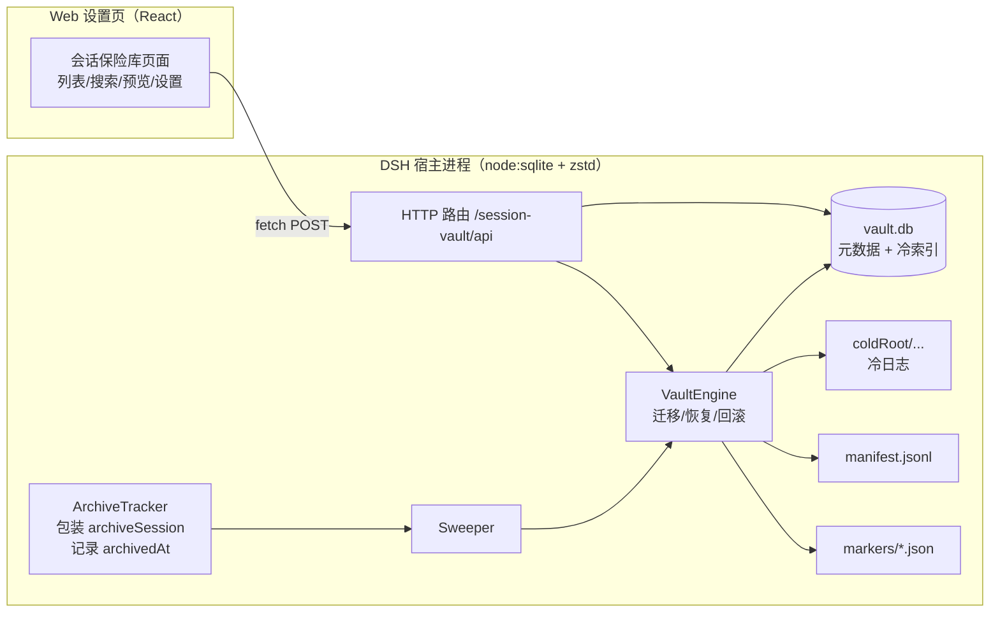
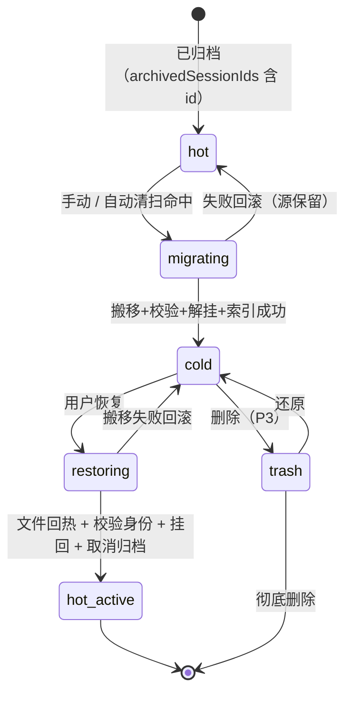

# dsh-session-vault（会话保险库）设计文档

- 版本：v0.2（草案，待用户确认；v0.2 依据两份调研备忘修订）
- 日期：2026-10-22
- 状态：待评审
- 需求来源：[需求档](2026-10-22-session-vault-requirements.md)
- 调研依据：[插件面](research/plugin-api.md) · [存储与检索](research/cold-storage.md)
- 目标宿主：DSH 0.2.1-rc.2（兼容 0.2.0-rc.1 起的 0.2.x）

## 1. 背景与目标（摘要）

把 DSH 的「归档」从纯标记升级为**可配置冷存储**：归档超过 N 天（默认 14）的会话自动搬离
`~/.dsh/sessions`，热目录只保留冷索引（元数据 + 全文 + 审计），需要时一键搬回并解除归档；
并提供归档管理 UI（列表/搜索/预览/收藏/批量/删除/诊断）。完整目标与非目标见[需求档 §3](2026-10-22-session-vault-requirements.md#3-目标)。

## 2. 现状约束（全部已核实）

> 证据坐标：**P1** `dsh-session-persistence-jsonl/lib/index.js`、**P2** `dsh-workspace/lib/index.js`、
> **P3** `dsh-session-query/lib/index.js`、**P4** `dsh-session-query-sqlite/lib/index.js`、
> **P5** `dsh-session-projection-cache/lib/index.js`、**P6** `dsh-session/lib/types/known-event-types.js`
> （均在 `resources/app.asar/dsh/node_modules/@deepseek-ai/` 下，与检出 `<workspace-root>\harness-checkout` 版本一致）。

| 编号 | 事实 | 证据 | 对设计的影响 |
| --- | --- | --- | --- |
| C-1 | 归档只写 `global.archivedSessionIds`，不动文件 | P2 `archiveSession()`；实测 118/118 目录仍在盘 | 冷存储必须自己搬文件 |
| C-2 | `archiveSession` 要求会话存在且非活跃；`unarchiveSession` **不做存在性检查** | P2:506-561（注释原文 `an entry whose session is gone still resolves`） | 恢复必须先搬文件再取消归档 |
| C-3 | 118 个归档 id 中 117 个仍在 `tables.workspaces[].sessionIds` 记账里 | `workspace.json` 实测 | 搬文件前 `detachSession`，恢复时 `attachSession` |
| C-4 | 工作区实体暴露 `attachSession`/`detachSession`，注册表暴露 `get/list/resolveByPath` | P2:102-104,178,209-215 | 记账解耦走公开方法，不手改 JSON |
| C-5 | `persistence.list()` 有四种状态：目录缺失→不列出；目录在但无合法代际名→静默跳过；**父 projectKey ≠ header.cwd→抛错**；同 id 两个 projectKey→duplicate 抛错 | P1:3048-3052、3411-3441、3468-3477、3125-3128 | 冷目录绝不能放在 sessions 之下；搬回必须回原 projectKey |
| C-6 | 内置 FTS 对账把「不在 `persistence.list()`」的行物理删除 | P4:656、681、760-769 | 冷会话必须自建索引 |
| C-7 | v4 日志是**多帧 zstd**（首帧 header + 每 append 一帧，带 xxhash），帧边界不解压可扫 | P1:1293-1297、1305-1368、3269-3281 | 自己实现帧遍历（不搜 magic，按结构走） |
| C-8 | 事件形状与注入：`user/message.data.source.kind` 只有 `user` 是真人输入；`assistant/message` 里 `reasoning` 占大头 | P3:545-588；抽取实测 | 索引只收 `kind=user` + assistant `text` + 标题 |
| C-9 | `node:zlib` 自带 `zstdDecompress`；`node:sqlite` 与 FTS5 可用 | 宿主 Node 24.21 / Electron 44 实测 | 不引入第三方原生依赖 |
| C-10 | 归档集合没有时间戳 | `workspace.json` 结构 | 自建 `archivedAt` 并回填 |
| C-11 | **会话身份 = 路径**：文件路径必须等于 `generationLogPath(root, header.cwd, header.id)` | P1:3468-3477；projectKey 算法 P1:880-900 | 恢复必须用 header.cwd 复算 projectKey；不一致一律 fail-closed |
| C-12 | 投影缓存已改为 per-record（`storages/session_projcache/sessions/<id>.json`），无「全表列会话」 | P5:89-101、168-197 | 搬走**不会**产生幽灵会话，只留孤儿缓存垃圾 |
| C-13 | 读 v0/v3 代际会**迁移写新文件** | P1:2123-2147 | 冷态只允许「只读第 0 帧」，禁止 `persistence.open` |
| C-14 | 写盘临时文件 `<log>.<hex>.tmp` 存在即表示写入在飞 | P1:3194 附近 | 迁移前见到 `*.tmp` 直接跳过本轮 |
| C-15 | 一个会话目录只放日志（无附件/锁/spill）；附件在全局 `~/.dsh/attachments/v1/` | 2083 个目录实测 | 搬移单位 = 整目录；附件不搬 |

### 2.1 数据安全不变量

完整版与三个重点工作区的实测影响见[安全边界档](2026-10-22-session-vault-safety.md)。摘要：

- 只处理 `archivedSessionIds` 中的会话；未归档会话**不读不搬**（I-2/I-3）；
- 迁移前校验 `目录名 == projectKey(header.cwd)`（I-4）；**迁移后复检**：若 id 已离开归档集合或出现 live 会话 → 立即搬回（I-6）；
- 恢复顺序固定：搬回 → `stat` 校验 → `attachSession` → `unarchiveSession`（I-7）；
- 冷目录必须在 sessions 之外、同卷优先（I-9）；任何失败都不删源，永久删除先进回收站（I-8）。

## 3. 架构



- **Host 核心**（纯逻辑、可单测）：`VaultStore`（DB）、`VaultIndexer`（帧遍历+抽取+分词+写入）、
  `VaultEngine`（状态机）、`ArchiveTracker`（archivedAt）、`Sweeper`（定时器）。
- **传输层**：`webServer` 前缀路由（仅本机、仅 POST），与 ZS/AM 同款安全口径。
- **客户端**：设置页独立页面，不接管官方侧栏（与 AM 的关键区别）。

### 3.1 插件形态与加载（已核实）

- **双半身包**：host = cordis 插件（`lib/index.js`）；client = `exports["./client"]` 指向的 bundle，
  格式必须是 `window.__ModuleLoader__.load({id,factory})`。
- **挂载**：bundle 走 `dsh.bundle.patch` 自带 `cordis.patch.yml` 的 insert 行；本地开发用 profile 依赖
  `"link:<workspace-root>/dsh-plugins/dsh-session-vault"` + 用户层 insert 行。
- **版本门**：`engines.dsh: ">=0.2.1-rc.2 <0.3.0"`（存在即忽略 peerDependencies；不匹配的 bundle 被静默跳过，insert 行不走这道门）。
- **设置页**：client 侧 `ctx.slots.inject('settings.section', …)`，宿主端零配套。
- **生命周期**：cordis 4.0.5 **没有 `'dispose'` 事件**；用 `ctx.effect(() => disposer)` 或 `apply` 返回 disposer；定时器用 `ctx.setInterval`。
- **路由**：`webServer.register({kind:'prefix', path:'/session-vault/api', handler})`；重复注册抛错；宿主不鉴权，
  必须自校验 loopback + `sec-fetch-site` + 同源 origin。

### 3.2 配置与生效语义

- cordis config 落 profile `cordis.patch.yml`，宿主侧有「改配置需重载/重启」先例 ⇒ **不作运行期配置**。
- 运行期配置存 `<DSH_HOME>/session-vault/config.json`，设置页经 `POST /session-vault/api/config` 读写，
  **即改即生效**（阈值、自动迁移开关、并发数在下一次清扫立刻生效）。
- 冷根目录变更只影响之后的迁移；已迁数据不自动搬，UI 明确提示。
- cordis config 仅在自有配置缺失时作为种子。

## 4. 数据模型

### 4.1 目录布局

```
<DSH_HOME>/session-vault/            # 插件数据目录（元数据；小）
  config.json                        # 运行期配置
  vault.db                           # SQLite：元数据 + 全文索引 + 状态
  manifest.jsonl                     # 追加式审计
  markers/<sessionId>.json           # 迁移/恢复中的崩溃标记

<coldRoot>/                          # 默认 <DSH_HOME>/session-vault/cold；必须与 sessions 同卷（D13）
  <projectKey>/<sessionId>/          # 与热目录完全同构，整目录原子搬移
  .trash/<sessionId>/                # 回收站（P3）
```

**硬约束**：`coldRoot` 必须在 `~/.dsh/sessions` **之外**（C-5：放进去会让 `persistence.list()` 抛错，
而 `WorkspaceRegistry.init` 直接 await 它 → 可能拖垮启动）。配置校验时直接拒绝并说明原因。

### 4.2 SQLite schema（版本 1）

```sql
PRAGMA application_id = 0x53565731;   -- "SVW1"，与官方 0x44534851、REF 0x53574954 都不同
PRAGMA user_version = 1;

CREATE TABLE meta (k TEXT PRIMARY KEY, v TEXT);

CREATE TABLE sessions (
  session_id     TEXT PRIMARY KEY,
  project_key    TEXT NOT NULL,       -- 原始 --xxx-- 目录名
  rel_dir        TEXT NOT NULL,       -- <projectKey>/<sessionId>，搬回目标相对路径
  log_name       TEXT NOT NULL,       -- 代际文件名，必须原样搬回（C-11）
  format_version INTEGER NOT NULL,    -- 0/3/4，从文件名解析
  file_size      INTEGER NOT NULL,
  file_mtime_ms  INTEGER NOT NULL,
  header_cwd     TEXT,                -- 复算 project_key 的唯一依据
  created_at     INTEGER NOT NULL,
  title          TEXT NOT NULL DEFAULT '',
  archived_at    INTEGER,             -- 自建；回填时=发现时间
  backfilled     INTEGER NOT NULL DEFAULT 0,
  moved_at       INTEGER,
  status         TEXT NOT NULL,       -- hot|migrating|cold|restoring|trash|hot-active
  favorite       INTEGER NOT NULL DEFAULT 0,
  error          TEXT,
  next_attempt   INTEGER,
  user_msgs      INTEGER NOT NULL DEFAULT 0,
  assistant_msgs INTEGER NOT NULL DEFAULT 0,
  first_user_text     TEXT NOT NULL DEFAULT '',
  last_assistant_text TEXT NOT NULL DEFAULT '',
  indexed_at     INTEGER,
  source_sha     TEXT NOT NULL        -- 第 0 帧 sha256 前 16 位，防同名异会话
);

CREATE TABLE docs (
  doc_id     INTEGER PRIMARY KEY AUTOINCREMENT,
  session_id TEXT NOT NULL,
  seq        INTEGER NOT NULL,
  type       TEXT NOT NULL,           -- user|assistant|title
  role       TEXT NOT NULL,
  time       INTEGER NOT NULL,
  text       TEXT NOT NULL,           -- 原文（预览/摘要）
  index_text TEXT NOT NULL            -- 分词后（中文插词边界）
);
CREATE UNIQUE INDEX docs_session_seq ON docs(session_id, seq);
CREATE INDEX docs_session ON docs(session_id);

CREATE VIRTUAL TABLE docs_fts USING fts5(
  index_text, content='docs', content_rowid='doc_id', tokenize='unicode61'
);

CREATE TABLE frames (                 -- 可选：定位原文某段，免全量解压（V2）
  session_id TEXT NOT NULL, idx INTEGER NOT NULL,
  start INTEGER NOT NULL, end INTEGER NOT NULL,
  PRIMARY KEY (session_id, idx)
) WITHOUT ROWID;
```

体积预期（调研实测）：正文 ≈ 原日志 2%~4%；118 个归档会话（932 MB 日志）→ 正文 20~40 MB、
FTS 库 25~70 MB，总量 < 100 MB。建库 1~3 分钟，可断点续做。

### 4.3 manifest 行

```json
{"ts":1792087437717,"op":"migrate","id":"session-...","from":"...sessions\\--ws--\\session-...","to":"...cold\\--ws--\\session-...","bytes":15313310,"files":1,"sha256":"...","ok":true,"reason":null}
```

## 5. 生命周期状态机



## 6. 迁移算法

### 6.1 前置校验（任一不满足 → fail-closed，不写任何文件）

1. `id ∈ registry.archivedSessionIds`；
2. `ctx.sessions.get(id) === undefined` 且 `workspace/session-activity` waterfall 返回空；
3. 源目录存在、仅含合法代际日志、**无 `*.tmp`**（C-14）、非符号链接；
4. 目录名 projectKey == `projectKey(header.cwd)`（C-11；不等说明该目录本身不一致，拒绝迁移）；
5. 目标路径不存在；`coldRoot` 与 sessions 同卷（跨卷需 `allowCrossVolume=true`）；
6. 无进行中的 marker；磁盘余量充足（跨卷 ≥ 源 × 1.2）。

### 6.2 伪代码

```text
async migrate(id):
  entry = store.get(id)                       # 前置 status == hot
  assert preflight(id)                        # 6.1
  src = sessionsRoot/projectKey/id
  dst = coldRoot/projectKey/id
  st  = persistence.stat(id)                  # 权威字节数
  writeMarker(id, {op:'migrate', src, dst, bytes: st.sizeBytes, phase:'planned'})
  if sameVolume(src, dst):
      await rename(src, dst)                  # 原子
  else:                                       # allowCrossVolume
      await copyDirChunked(src, dst + '.partial', 8MB)
      await fsyncTree(dst + '.partial')
      assert sha256Tree(dst + '.partial') == sha256Tree(src)
      await rename(dst + '.partial', dst)
      await removeDir(src)
  writeMarker(id, phase:'moved')
  # I-6 迁移后复检（防竞态：校验后被取消归档 / 被打开）
  if id not in registry.archivedSessionIds or ctx.sessions.get(id) != undefined:
      await moveBack(dst, src); deleteMarker(id); store.upsert(status='hot', error='race-unarchived'); return
  for ws in registry.list():
      if id in ws.sessionIds: await ws.detachSession(id)
  await indexer.index(id, dst)                # 失败只记录，不阻塞
  store.upsert(status='cold', moved_at=now, ...)
  appendManifest({op:'migrate', ok:true})
  deleteMarker(id)
```

### 6.3 后置条件

- 热目录不存在；冷目录存在，文件数/字节数/sha256 与源一致；
- 工作区记账已解挂；`archivedSessionIds` **不变**；
- DB `status=cold`；manifest 恰一行；marker 已删；
- 索引可搜到（索引失败则 `error` 非空，可重建）。

## 7. 恢复算法（顺序是硬约束）

```text
async restore(id):
  entry = store.get(id)                       # 前置 status == cold
  src = coldRoot/rel_dir
  header = readHeaderOnly(src/log_name)       # 只解第 0 帧；v0/v3 绝不开 persistence（C-13）
  pk = projectKey(header.cwd)                 # 与宿主 P1:880-900 同算法
  dst = sessionsRoot/pk/id
  assert exists(src) and not exists(dst)
  assert header.id == id
  writeMarker(id, {op:'restore', phase:'moving'})
  move src -> dst                             # 同卷 rename / 跨卷 copy+verify+rm
  assert persistence.stat(id) !== undefined   # 身份校验（路径 == generationLogPath）
  ws = await registry.resolveByPath(header.cwd)
  if ws and id not in ws.sessionIds: await ws.attachSession(id)
  await registry.unarchiveSession(id)         # C-2：文件已回，安全
  store.upsert(status='hot', moved_at=null)
  appendManifest({op:'restore', ok:true})
  deleteMarker(id)
```

**失败策略**：搬文件失败 → 回滚冷态（marker 清理，可重试）；文件已回但 attach/unarchive 失败 →
**不回滚**（保持热态），记 `error` 并提供「重试完成恢复」。原因：来回搬文件的风险大于重试一个幂等调用。

## 8. 冷索引与搜索

### 8.1 帧遍历与解码（C-7）

```text
scanFrames(buf):                       # 按结构走，不猜边界
  loop:
    magic(u32 LE) == 4247762216 否则 torenStart
    fhd = u8; 校验保留位; 读 window/dict/fcs 余量
    loop: 3 字节块头 (last/type/size) → 跳过块体（RLE=1 字节；type 3 保留→错误）
    checksum 则跳 4
    记录 {start,end}
  返回 { frames, tornStart }
```

- 只读头部 = 只解 `frames[0]`（header 行以 `\n` 结尾）；
- 全量读 = 逐帧 `zstdDecompressSync` 拼接；任一帧失败 → `error='frame-corrupt'`，**不写半截索引**；
- 容忍「打包行」（`text-chunks` 等无 `type` 的数组帧）：解码后逐事件处理。

### 8.2 文本抽取（C-8）

```text
user/message      : data.source.kind == 'user' 才收（runtime-context/time-context/skill-catalog/
                    agent-instructions/tool-jobs/user-approval 一律不收）
                    → data.content[].type=='text'
assistant/message : data.message.content[] 中 type=='text'（reasoning / tool-call 丢）
session/title     : data.title
其他事件           : 不收（turn/start、step/*、request/header、system/message、tool/*）
```

### 8.3 分词（中文可搜）

- 中文：`Intl.Segmenter('zh', {granularity:'word'})` 插词边界空格（与 REF 同法，索引/查询同一函数）；
- 拉丁：小写化；
- 混合：两套 token 合并并空格连接，写入 `index_text`；查询侧同函数处理后 `MATCH`。

### 8.4 一致性与重建

- **覆盖面**：归档时即建索引（热归档也能搜）；迁移时复用（字节未变则跳过）；恢复后保留，便于再次归档。
- 迁移事务内写索引；失败不阻塞迁移，`error='index-failed'`，列表可点「重建索引」；
- `rebuildIndex()`：清 docs 后按 `file_size/file_mtime/format_version` 断点续扫；
- 删除/回收站同步删行；
- 冷清单与 `archivedSessionIds` 每次启动对账，不一致以 registry 为准并记差异。

## 9. 自动清扫与 archivedAt

- 启动后 60 s 首次扫描，此后每 `sweepIntervalMinutes`（默认 30）；`autoMigrate=false` 不跑。
- 候选：`status=hot` + `archivedAt + ageDays*86400e3 <= now` + `next_attempt <= now`；按 archivedAt 升序，单轮上限 5。
- `archivedAt` 来源：包装 `archiveSession` 写入；存量回填 = 首次发现时间（`backfilled=1`，UI 标注「回填」），
  因此现有 118 个默认再等一个阈值周期；用户可手动「立即迁移」。
- 失败退避：`next_attempt = now + min(6h, 5min * 2^failures)`。
- 暂停条件：检测到 AM 插件、coldRoot 不可用、跨卷未开启、`restoring` 未收敛。

## 10. UI 信息架构

完整交互稿见 [UI 设计档](2026-10-22-session-vault-ui-design.md)（Placement / 线框 / 交互矩阵 / 状态文案）。

| 区块 | 内容 |
| --- | --- |
| 顶部统计 | 归档数（热/冷）、冷存储占用、阈值、下次清扫 |
| 搜索框 | 标题/正文；结果带 snippet（P2） |
| 列表 | 标题 · 工作区 · 大小 · 归档时间（回填标记） · 状态 · 操作；全选/批量 |
| 行操作 | 迁移 / 恢复 / 预览 / 收藏 / 删除 |
| 设置 | 冷根目录、阈值、自动迁移、清扫间隔、并发、跨卷开关；保存即生效 |
| 诊断 | 读失败列表 + 修复入口（P3） |

**列表数据源**（合并去重）：

- 热归档 = `registry.archivedSessionIds` ∩ `persistence.list()`（尚未迁移，大小取 `persistence.stat().sizeBytes`）；
- 冷归档 = `vault.db` 的 `status=cold/trash/lost` 行（不读日志，秒出）；
- 两边对不上时以 registry 为准，差异写 `manifest` 并在 UI 标注。

**动作**：归档/取消归档（调官方 API，成功后记录 archivedAt）、迁移、恢复、预览、收藏、删除。

接口（全部 POST、仅本机）：
`/session-vault/api/{list,status,migrate,restore,archive,unarchive,search,preview,config,delete,repair,rebuild-index}`

## 11. 崩溃恢复矩阵

| 崩溃点 | 磁盘态 | 启动收敛 |
| --- | --- | --- |
| marker 前 | 热完整 | 无事 |
| marker 后、rename 前 | 热完整 + marker | 删 marker |
| rename 后、detach 前 | 冷完整 + 记账残留 | detach + 索引 + 收尾 |
| detach 后、DB 前 | 冷完整、无记账 | 索引 + 收尾 |
| DB 后、manifest 前 | 冷完整 + DB | 补 manifest |
| 跨卷 copy 中断 | 热完整 + `.partial` | 删 `.partial` |
| 跨卷 copy 完、删源前 | 冷完整 + 热完整 | 校验 cold 后删源 |
| 恢复：文件回热、unarchive 前 | 热 + 仍归档 | attach/unarchive |
| 恢复：unarchive 后、DB 前 | 热 + 已解归档 | 收尾 DB |
| 目标卷中途拔出 | 热完整 + 残留 | 删残留，提示，状态 hot |

启动还做 **vault ↔ DB 对账**：冷目录有、DB 无 → 导入 cold（索引后建）；DB 有、磁盘无 → `error='lost'`，**不删行**。

## 12. 防偏离（验收锚）

| 锚 | 类型 | 断言 |
| --- | --- | --- |
| A-1 | 正向 | 迁移后：热目录不存在、冷目录 sha256 一致、记账已 detach、manifest 恰一行 |
| A-2 | 负向 | 未归档 id / 活跃 id 永不进入迁移队列 |
| A-3 | 正向 | 崩溃矩阵每点重启后收敛为「热完整」或「冷完整」，无第三态 |
| A-4 | 正向 | 恢复后 `persistence.stat(id)` 可见、`sessionIds` 含 id、`archivedSessionIds` 不含 id、projectKey == header.cwd 复算值 |
| A-5 | 正向 | 冷搜索命中真人正文；**注入消息（runtime-context 等）与 tool 参数不得被索引**（负向） |
| A-6 | 正向 | 跨卷中断后源完整、`.partial` 被清、可重试成功 |
| A-7 | 负向 | coldRoot 不可用时列表只读，不产生删除/搬移 |
| A-8 | 正向 | 设置页改阈值后，下一次清扫立即按新值执行（不重启） |
| A-9 | 正向 | 包装卸载后 `registry.archiveSession` 恢复原引用；重复挂载只叠一层 |
| A-10 | 负向 | projectKey ≠ header.cwd 的会话被拒绝迁移（不允许制造 `list()` 抛错源） |
| A-11 | 负向 | coldRoot 配在 sessions 之下时，保存配置直接拒绝 |
| A-12 | 正向 | 迁移后复检发现已取消归档/出现 live 会话时，自动搬回并标 `race-unarchived` |

## 13. 边界

- **空集**：无归档会话 → 空态、清扫 no-op。
- **同卷/跨卷**：同卷 rename（默认）；跨卷 opt-in，copy+verify+rm，可取消、有进度。
- **权限/盘拔出**：fail-closed，不删任何数据；状态接口 `vaultUnavailable`。
- **并发**：所有写操作进 `VaultEngine` 单串行队列；HTTP 层按 id 去重。
- **大文件**：8 MB 分块、每块 `setImmediate`；单会话最大实测 34.5 MB，预留 2 GB 上限。
- **损坏日志**：帧遍历失败 → 默认拒绝迁移；用户勾选「跳过索引」才允许（metadata-only）。
- **v0/v3 冷会话**：只读第 0 帧；预览手动解码；恢复后不主动 open（C-13）。
- **子代理会话**：按 id 独立；父子一冷一热合法。
- **升级**：`user_version`；不兼容则只读打开并提示重建。
- **同名异会话**：`source_sha` 校验，不匹配则 `error='identity-mismatch'`。

## 14. 决策记录

| 编号 | 决策 | 理由 | 被否决的备选 |
| --- | --- | --- | --- |
| D1 | **自研插件**，不 fork AM | AM 把缺失工件判为丢失并删归档标记（与冷存储冲突）、接管侧栏与投影缓存 | fork AM：继承冲突与侵入性；fork ZS：无迁移/搜索且 0.1.x |
| D2 | 用**设置页**，不接管侧栏 | 侵入最低，避免与 dsh-better-sidebar 等冲突 | 接管侧栏：升级易碎 |
| D3 | 冷根目录默认同卷 `<DSH_HOME>/session-vault/cold` | rename 原子；跨卷复制慢且崩溃风险高 | 默认外置盘 |
| D4 | 阈值以 **archivedAt** 为准，存量回填=发现时间 | 忠于「归档超过 N 天」；回填保守 | 用 mtime：不是归档时间 |
| D5 | 索引 = **SQLite + external-content FTS5 + Intl.Segmenter 预分词** | 无原生依赖、中文可搜、体积小 | JSON 倒排；复用官方库（会被对账删行） |
| D6 | 迁移时 **detach** 记账，恢复时 **attach** | 消除僵尸 id 与启动 warn（C-3） | 保留记账 |
| D7 | 恢复顺序 **先搬文件 → 再 unarchive** | C-2：反序会出现指向空气的可见会话 | 先 unarchive |
| D8 | 删除先入 **回收站** | 不可逆操作降风险 | 直接删 |
| D9 | 版本门写 `engines.dsh` | 存在即忽略 peers；语义清楚 | 逐包 peer：冗长易错 |
| D10 | 运行期配置放**插件自有 JSON** | 改配置即生效，不依赖宿主重载 | cordis config / settings.update：要重载 |
| D11 | 服务包装只做**实例 overlay**，不换服务对象 | 替换会让 `workspaceController` 失效 | `ctx.set` 替换 |
| D12 | v1 只做 **HTTP 路由**，不做 typert RPC 面 | 少踩 codec strict/重复注册 | typert |
| D13 | 冷目录**必须同卷**；跨卷需显式 `allowCrossVolume` | 跨卷复制有半目录崩溃窗口（C-15/调研） | 默认允许跨卷 |
| D14 | 冷目录**禁止放在 sessions 之下** | C-5：会让 `persistence.list()` 抛错，可能拖垮启动 | 允许任意路径 |
| D15 | 索引 schema 抄 REF 三件套（独立 application_id + external-content FTS + watermark） | 防被官方库重置、增量简单、库小 | 照搬官方 schema |

## 15. 实施阶段

| 阶段 | 交付 | 验收 |
| --- | --- | --- |
| P0 | 脚手架：包结构、client bundle 构建、设置页壳、路由、配置存储 | 设置页可打开、接口 200 |
| P1 | VaultStore/Indexer/Engine + 迁移/恢复 + 列表 UI + manifest + 崩溃矩阵 | AC-1、AC-2、AC-4、AC-5、AC-10 |
| P2 | Sweeper（自动迁移）+ archivedAt 回填 + 搜索 + 预览 | AC-3、AC-6、AC-7 |
| P3 | 收藏 + 回收站/删除 + 诊断修复 | P3 用例、AC-9 |
| 收尾 | 跨卷回归、与 AM 共存检测、全量迁移演练（118 个） | AC-3、AC-4、AC-8、AC-9 |

## 16. 工程约束与已知坑

调研明细见 [research/plugin-api.md](research/plugin-api.md)（269 行，含骨架与 11 条坑清单）。
必须遵守：

| # | 约束 | 后果 |
| --- | --- | --- |
| 1 | 不用 `ctx.on('dispose')`，只用 `ctx.effect`/返回 disposer | cordis 4.0.5 无该事件，定时器/监听泄漏 |
| 2 | 包装 `archiveSession` 用符号守卫 + 引用比对还原 | 热重载叠 N 层 / 误删别人的包装 |
| 3 | 不替换 `workspaceRegistry` 服务对象 | 卸载后工作区控制器 unavailable |
| 4 | 路由带插件前缀 | 重复 `(kind,path)` 直接抛错 |
| 5 | 自校验 loopback/Origin | 宿主不鉴权，任意网页可 POST |
| 6 | 写 `engines.dsh`；本地开发走 insert 行 | bundle 不匹配被静默跳过（界面全无） |
| 7 | 不写死 `~/.dsh`，用 `DSH_HOME` | 换 profile/工作区错位 |
| 8 | client bundle 必须真的构建出来 | 缺失是组合期硬错 |
| 9 | host 代码默认不热重载 | 改 host 需重启（用户定时机）；client 重建即热更 |
| 10 | 不假设 cordis 配置即时生效 | 运行期配置走自有 JSON（D10） |

开发循环：client 重建 → 500ms stat-poll + SSE 自动刷新（不重启）；host 改动 → 重启（用户决定时机）。
测试策略：引擎层（状态机、帧遍历、分词、崩溃收敛）纯 Node 单测 + 注入式假文件系统；
端到端只做「单会话迁移 → 重启 → 验证不可见 → 恢复 → 验证可打开」人工验收（重启需用户同意）。

## 17. 本批不做

- 不接管官方侧栏、不替换 workspaceRegistry 实现（只包装归档两个方法）。
- 不做加密、云同步、跨机器迁移。
- 不做向量检索、会话合并、ZIP 导出。
- 不迁移未归档会话。
- 不动 DSH 核心与会话格式（只读日志）。
